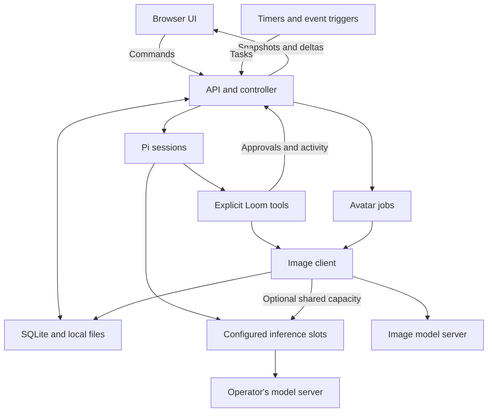

# Agent Loom architecture

This document describes version 0.2.0. [RESEARCH.md](RESEARCH.md) explains the upstream references; [API.md](API.md) describes the browser-facing endpoints and [MODELS.md](MODELS.md) covers model configuration. [MAIL.md](MAIL.md) covers external mail connections and service identities.

## Process boundaries

Loom runs as one Node.js process with a React browser client. The operator supplies the inference server. The production process serves the built frontend and API on the same origin; development uses Vite and an API proxy.

Inference slots cover individual model requests, including context compaction and, by default, image generation. They do not cover entire tasks. A session awaiting an ordinary tool or approval leaves model capacity available to another bot. The application data directory identifies one Loom instance; room working folders are separate execution settings, not separately switchable app instances.

## Code ownership

| Area                    | Main files                                                                                                             | Responsibility                                                                                                                                             |
| ----------------------- | ---------------------------------------------------------------------------------------------------------------------- | ---------------------------------------------------------------------------------------------------------------------------------------------------------- |
| Browser                 | `src/client/`                                                                                                          | Rooms, chat, approvals, bots, automations, mail/service accounts, learning, notifications, settings, and English/Japanese display.                         |
| Shared contract         | `src/shared/types.ts`, `model-limits.ts`, `model-settings.ts`, `avatars.ts`, `mail-accounts.ts`, `service-accounts.ts` | Serializable entities, event shapes, token bounds, reasoning values, model defaults, allowed avatar sources, and provider-neutral account/draft contracts. |
| HTTP process            | `src/server/index.ts`, `app.ts`                                                                                        | Listening address, authentication, same-origin checks, static files, SSE, startup and shutdown.                                                            |
| Application state       | `src/server/controller.ts`                                                                                             | Durable task identities, room membership, status transitions, approval resolution, memory/skill records, and UI events.                                    |
| Routes and integrations | `src/server/routes.ts`, `account-routes.ts`, `integrations.ts`                                                         | Validated CRUD, model discovery, settings, webhook authentication, mail/service endpoints, and automation configuration.                                   |
| Store                   | `src/server/store.ts`                                                                                                  | SQLite objects, encrypted secrets, deduplication records, initial data, and encryption-key storage.                                                        |
| Agent runtime           | `src/server/runtime/index.ts`                                                                                          | Pi embedding, bot-by-room sessions, model provider configuration, streaming, usage, compaction, cancellation, and learning tasks.                          |
| Inference queue         | `src/server/runtime/gate.ts`                                                                                           | Abortable 1–16-slot admission, live capacity changes, per-room response admission and foreground priority.                                                 |
| Image generation        | `src/server/runtime/images.ts`                                                                                         | Separate image-model requests, bounded raster outputs, persistent attachments and safe image-file reads.                                                   |
| Avatar jobs             | `src/server/avatar-generations.ts`                                                                                     | Durable UUID requests, direct user consent, progress/cancellation, replay prevention and restart recovery.                                                 |
| Tools                   | `src/server/runtime/tools.ts`, `mail-tools.ts`                                                                         | Deliberate tool registry, permission checks, operation journal, handoff limits, and notifications.                                                         |
| Automatic approval      | `src/server/runtime/approval-policy.ts`                                                                                | Deterministic exact-operation rules and bounded built-in inspection equivalents.                                                                           |
| I/O boundaries          | `src/server/runtime/network.ts`, `workspace.ts`                                                                        | Bounded network responses, public-address checks, text extraction, workspace file resolution, and file limits.                                             |
| Scheduler               | `src/server/scheduler.ts`                                                                                              | Interval checks, URL baselines, provider mail cursors/pending queues, buffered webhooks, and per-rule task overlap prevention.                             |
| Mail account service    | `src/server/mail-accounts.ts`, `mail-providers/`                                                                       | Scoped external transport, bounded reads, exact draft revisions and durable send receipts.                                                                 |
| Account migration       | `src/server/mail-account-migration.ts`                                                                                 | Idempotent legacy IMAP migration with preserved UID cursors and no network calls.                                                                          |
| Service registry        | `src/server/service-accounts.ts`                                                                                       | Independent service identity metadata and encrypted, write-only credential values.                                                                         |

## State and event delivery

SQLite is the source of truth for application records. The initial schema uses a typed object collection (`kind`, `id`, JSON `data`), plus tables for encrypted secrets, deduplication, and event records. SQLite runs in WAL mode. Pi's own session transcripts live in separate files under the same data directory.

The store obtains a connection-lifetime exclusive database lock before schema setup, seeding, or controller recovery. A second owner of the same directory fails before it can mark live tasks interrupted or cancel approvals. The operating system releases the lock when the owning process exits, including a crash.

`GET /api/state` returns a complete snapshot. Server-sent events send incremental answer text, separate provider-reported reasoning, persisted message patches, and fresh snapshots. The controller coalesces snapshot notifications over an 80 ms window; a reconnected client receives a current snapshot rather than trying to reconstruct truth from a missing browser tab. Room IDs and membership are database records. The selected room, chat drafts, and display preferences can remain in browser storage. Mail drafts and send receipts are server-side SQLite records. Account snapshots expose safe metadata and configured-secret indicators, not stored credential values.

The current version returns unpaginated snapshots and retains history. It is intended for a small personal workspace, not a large deployment with many simultaneous users or an unlimited audit archive. Pagination, retention controls, and explicit migration tooling are future scaling work. There is no browser-side inference or authoritative browser-only task queue.

### Task state presentation and approval attention

`src/client/task-status.ts` derives a display phase from the authoritative task status, current queue reason, latest bot-run message, pending approvals and live connection. `waiting_model` is admission waiting in this runtime; it is not presented as an actively generating model. An active `running` task can show preparation, reasoning or answer generation using current streamed content. Terminal task status always wins over stale message flags. Lost connectivity marks nonterminal work unconfirmed without inferring failure or cancellation.

`RoomActivity` sits outside the message scroll container above the composer. It prioritizes a bot's pending/active task over settled history, retains distinct terminal states, and opens existing exact approval cards in the established modal component. Room membership and live task/approval ownership determine which bots appear. Review lists are scoped to a keyed room and sorted oldest first; inline cards retain their original run ownership. `ApprovalCard` shares a small in-flight decision store across its inline and dialog copies so a user cannot concurrently submit the same pending request from both.

App-level room badges, cross-room navigation and document-title counts expose approvals that the selected conversation does not contain. These UI additions do not alter permission decisions, task scheduling or tool execution. Only explicit task navigation changes reading position; new approvals and output preserve an upward-scrolled conversation. The client uses state transitions and connection evidence rather than percentage estimates or silence-based failure timers.

## Model requests and sessions

The runtime registers the configured endpoint with Pi as an OpenAI-compatible chat-completion provider. The initial adapter is text-only and uses streaming responses. Credentials remain in the backend. Pi's model catalog does not automatically fetch cloud catalogs, and Loom does not discover arbitrary CLI extensions or workspace instruction files.

Model token bounds live in `src/shared/model-limits.ts` and are used by the settings schema and selectors. Context supports 2,048–2,097,152 tokens and output supports 128–1,048,576. The UI offers powers of two while retaining arbitrary saved values; the API continues to accept in-range integers. Maximum output must be strictly smaller than context. Selecting a value does not reconfigure the external inference server or overwrite saved/default budgets.

Pi compacts history when estimated context usage exceeds the context window minus its reserve. Loom targets the selected output budget plus 4,096 safety tokens, bounded to retain some input space for small contexts or extreme custom output values; recent-history retention also accounts for the output budget. This replaces the previous context/3 ceiling, which could leave insufficient reserved room for half-context output choices such as 1M context / 512K output. Pi's request adapter independently clamps output to estimated available context minus its safety margin. A configured maximum therefore does not guarantee that many output tokens on every request. See [context/output examples](MODELS.md#context-and-output-budgets).

Reasoning defaults to the server's own behavior and omits `reasoning_effort`. Explicit mode sends one of `none`, `minimal`, `low`, `medium`, `high`, `xhigh`, `max`, or `ultra` literally. `reasoning.ts` supplies Pi with a provider thinking-level map, including `off → none` and the selected `max` or `ultra` mapping, so SDK normalization does not silently reduce a selected effort. These are configurable request values, not a claim that every model supports every level. Unsupported extensions such as `ultra` can be rejected by the server.

Pi's actual non-redacted thinking deltas are persisted and streamed into a separate message field, capped at 64,000 characters with explicit truncation and completion/interruption state. Loom does not synthesize reasoning for models that omit it. Intermediate assistant updates before tool calls are preserved in the activity timeline so the answer field can contain the eventual answer separately.

Saved model credentials are reused only within the saved URL origin. Connection tests against another origin require an explicitly supplied credential; changing the saved origin clears an omitted key. The settings route compares normalized values before blocking execution-sensitive edits during active work, so submitting an unchanged model/workspace alongside a permission or learning change is allowed.

A separate Pi session directory is selected for each **bot × room** pair. Several bots may share the same model but keep distinct session transcripts and instructions. The current room's recent completed public messages are supplied as bounded context; partially streaming and error messages are excluded. The `room_context` tool follows that completed-message rule too. Concurrent peers do not automatically consume one another's live fragments. Shared memories and that bot's own memories are included; other bots' private session transcripts are not copied into the prompt.

The global gate accepts `Settings.inference.maxConcurrentRequests` from 1 to 16, defaulting to 1. Capacity changes apply live: increasing admits eligible waiters, while decreasing leaves active requests running and drains to the new limit. Queue `active` can therefore temporarily exceed `capacity` after a reduction. Waiting work is FIFO among eligible foreground requests; learning takes spare capacity and does not preempt running work. A room awaiting its own turn does not block an independent eligible room.

`Room.parallelResponses` defaults to false. In that mode, the gate admits at most one response request in the room at a time. True allows distinct bot sessions in that room to share available global slots. This is a per-request room rule; it does not lock the whole room while a bot awaits a tool, approval, or another model turn. Tool operations from different bot tasks can overlap and room folders are not filesystem transaction locks.

A second queue above the inference gate keeps a bot × room session exclusive while allowing up to 16 tasks to reach a model/tool boundary. The same session is never entered concurrently, even in a parallel room. The queue exposes capacity, model/session wait counts and per-task reasons (`inference`, `room`, `session`, `worker`) for the UI. Tool and approval waits remain separate task states. The task queue is bounded to 200 active/queued tasks. A normal task is bounded to 30 model requests and 40 tool calls; a learning task gets at most six model requests. These are termination limits, not a task-success guarantee.

The gate submits separate HTTP requests. The external inference engine owns continuous batching, prefill/decode interleaving, KV-cache management and GPU execution. App-level concurrency makes simultaneous requests possible; it does not assert an engine optimization or guarantee a latency gain.

## System-prompt draft jobs

`src/server/prompt-generations.ts` owns user-initiated prompt drafts. It snapshots the configured text model and credential, reserves the runtime's shared inference gate, and calls Pi's streaming OpenAI adapter with no tools or agent session. The request contains only the supplied name, role, instructions, locale, and optional existing prompt; it does not load room conversation, memories or files. The prompt asks for an editable role-specific instruction document and makes clear that application permissions, tools and schedules cannot be created by wording alone.

Each UUID identifies one durable request. Identical replay returns the same job; conflicting content returns 409. One helper job can be active at a time, output is bounded and persisted roughly every 150 ms, and the editor polls active jobs once a second. The helper cap is 4,096 tokens or the configured output limit if lower. Complete text must also fit 32,000 characters; empty, truncated, tool-call or unfinished output fails. A conservative input allowance rejects oversized contexts before admission, and a cancellable ten-minute generation timeout begins after queue admission.

Closing the editor cancels its HTTP observers but leaves the server job running. Stop aborts its queued/active request and releases capacity. Shutdown and restart mark unsettled jobs interrupted without replay. Text-model and demo changes are blocked while generation is active. Partial and completed text are distinct from bot settings: the user reviews/edits a completed draft, applies it to local form state, and saves through ordinary bot POST/PATCH. Undo restores the editor's previous text. Recent results remain available independently of unsaved form edits.

## Image generation and attachments

`generate_image` uses the independently configured Images endpoint, model ID and encrypted `image.apiKey`. It posts one prompt and size to `/images/generations` using the OpenAI-compatible Images protocol. Auto response format omits the legacy field; explicit Base64 sends `response_format: b64_json`. Native ComfyUI workflow APIs are outside this adapter.

The tool follows the network permission and operation journal. Auto requests manual review of generation rather than treating it as a safe web read. Approval happens before an image request reserves inference capacity. A per-host semaphore permits one image generation at a time. With `shareInferenceSlot` true, an image also acquires the global gate with its task/room context; false permits image/text overlap without taking a text slot. A change to Deny while it waits prevents submission. Stopping releases local queues and aborts I/O; the image server may still finish work it already accepted.

Outputs may be base64 data or an image URL. POST redirects are rejected rather than replaying generation. Same-origin image downloads may access the configured private server; other origins must resolve to public addresses. DNS is pinned, redirects and response bytes are bounded, and API keys are not forwarded to another origin. The client validates PNG/JPEG/WebP signatures and dimensions, rejects SVG, and caps each image at 20 MiB.

Images are stored with exclusive creation under `generated-images` inside the app data directory. They are not written into arbitrary room paths. Tool-generated metadata is attached to the generating task's current message; avatar-job metadata is attached to its persisted job. Both index the raster as an `images` record, and startup repairs those indexes from the owning records. `GET /api/images/:id` reads only validated app-managed files with authentication, `nosniff`, and private/no-store caching. Download mode adds an attachment disposition. Symlink paths and changed file sizes/media types are rejected.

A completed journal result contains image metadata. Repeating that exact tool operation after resume restores the attachment to the new message without regenerating it. Started/failed records block automatic replay because the remote outcome may be uncertain. Model context receives metadata, not image pixels or provider download URLs; the text adapter cannot claim visual inspection or certify image quality. Backups must include generated image files with the database and key.

### Character-avatar pipeline

`Bot.avatar` resolves through an allowlist of eight bundled character paths or an app-managed image identifier. Legacy icons and symbols remain supported. The shared resolver never treats arbitrary avatar text as a remote URL, filesystem path or markup. The store seeds character defaults and performs a one-time migration of the two original default icons, preserving customized avatars, deleted bots and later user selections.

The shared avatar component renders `Bot.color` as a visible accent frame around portrait images, including generated avatars, while retaining fixed outer dimensions. The profile editor previews color changes in its draft and saves them with the bot. Production smoke validation imports the compiled shared character catalog and checks every listed WebP asset through the HTTP server.

The profile editor submits a UUID and appearance prompt to `avatar-generations.ts`. That module persists a job before starting image work and reuses the same validated image client, serialized image gate, optional global inference gate and encrypted image credential as chat tools. It does not create a Pi session, bot task or room message. Only one avatar job can be active across the application. Generate is direct consent for that request; Network Deny still blocks admission or later dispatch. Image/text execution settings and credentials remain pinned while a job is active.

The editor observes persisted `queued`/`generating` state, previews a completed image, and lets the user select it before saving the bot. Closing the editor does not cancel generation. Reposting the same UUID and trimmed prompt returns the same job; changing the prompt under that UUID is rejected. Cancellation retains the job record, while shutdown or restart marks unfinished jobs interrupted. Terminal jobs are never replayed automatically; another deliberate attempt uses another UUID. The recent list exposes 20 jobs, with older records still retrievable by ID. This job protocol handles client/navigation recovery without claiming remote exactly-once execution. See [avatar API](API.md#avatar-generation-jobs) and [avatar usage/artwork](AVATARS.md).

## Room workspaces and native selection

`Room.workspacePath` optionally overrides `Settings.workspacePath`. The controller pins the effective folder on `Task.workspacePath` at queue admission. Handoff and learning tasks inherit the parent's folder; independent automatic tasks resolve their destination room. Legacy tasks are pinned at startup and before path-setting changes. Runtime copies of settings substitute the pinned root before constructing tools, prompts, and Pi sessions. Pi's recent-session selection filters transcripts by working directory within the bot × room directory.

Room-folder changes require that room to have no active tasks. Resume compares the pinned root with the current room root and refuses a mismatch, preventing a side-effect journal from being reused against a different directory.

`src/server/native-folder.ts` owns native chooser processes. Its API uses existing authentication/same-origin checks and additionally requires unforwarded loopback access through a loopback host. The dialog opens on the Node host, not a remote browser's computer. Paths are passed as data to static native programs. Only one chooser is active at a time; cancellation, timeout, and shutdown clean up the process. Results must be absolute existing directories. The UI saves the selected path only when the owner saves the form.

Windows uses the Common Item Dialog in folder mode via PowerShell; macOS uses `osascript`; Linux uses an available `zenity` or `kdialog` in a desktop session. Unsupported, headless, and remote installations expose an unavailable state and an explicit server-path fallback.

## Task states and recovery

| State               | Meaning                                                                       |
| ------------------- | ----------------------------------------------------------------------------- |
| `queued`            | Accepted and recorded; waiting for a session/runtime slot.                    |
| `waiting_model`     | Waiting for inference capacity or the room's response turn.                   |
| `running`           | The agent is generating or advancing its loop.                                |
| `waiting_tool`      | A tool is executing or waiting for its own resource, such as the image queue. |
| `awaiting_approval` | An exact proposed operation is waiting for the owner.                         |
| `completed`         | This task's agent loop completed.                                             |
| `stopped`           | The owner or orderly shutdown cancelled execution.                            |
| `interrupted`       | Work was found active after restart or never started before shutdown.         |
| `failed`            | The runtime reported an error that needs inspection.                          |

Only stopped, interrupted, or failed tasks can be resumed explicitly. The existing task ID is retained. Startup converts formerly active tasks to interrupted, cancels stale approvals, and marks unfinished message/activity records accordingly. Saved conversations remain available regardless of execution state.

Side-effecting tools journal a key derived from the task ID, tool name, and canonical arguments. A completed exact operation returns its saved result on replay. An operation recorded as started or failed is refused on automatic retry because its external outcome may be uncertain. The owner can inspect the target and start a new task when another attempt is appropriate.

This prevents a particular class of accidental repeats; it is not a distributed exactly-once protocol. A semantically similar command with different arguments has a different key, a stopped external process may already have produced effects, and an external service may have completed work just before a crash. Recovery must preserve and expose those limits.

## Chrome adapter

`src/server/browser.ts` owns a single, serialized browser connection per Loom instance. It starts the pinned installed Chrome DevTools MCP child through the MCP SDK's stdio transport, with explicit fixed arguments and a minimal desktop environment. No shell command, runtime `npx` install or extra LLM loop is involved. Ordinary app startup and cached status reads do not connect. Existing Chrome uses Chrome's own consent flow; dedicated mode uses an app-owned persistent profile. Disconnect aborts queued work, closes the child, invalidates page states and pauses implicit reconnection.

The runtime exposes the deliberately limited `browser_use` tool only to ordinary enabled bot sessions, not learning runs. A synchronous preparation stage checks cached page state and creates a concrete approval request without browser I/O. After approval, the browser queue rechecks current permissions and connection identity, refreshes the page URL and relevant accessibility state, and consumes the snapshot before a mutation. The global browser queue is separate from the inference gate, so bot/model concurrency does not turn into simultaneous Chrome input. Mutation receipts use the existing durable operation journal; stale/uncertain actions require inspection rather than automatic replay.

Loom control origins and loopback aliases on their ports are protected. HTTP(S) and `about:blank` are the supported navigation destinations. Page text is bounded and marked as untrusted; arbitrary evaluation, file navigation, network/header inspection and browser shortcuts are not exposed. This is an operation boundary for a trusted owner's browser, not process isolation or a guarantee against page changes after a check.

Viewport screenshots share the existing bounded raster validation and authenticated image store. Their pixels are emitted as Pi image content only when the owner enables screenshot model input; the provider model's input capability is updated accordingly. Text-only sessions receive attachment metadata while retaining DOM/snapshot control. API/Settings status checks never consume model requests. The upstream adapter's usage statistics, CrUX, update checks and config discovery are disabled. See [browser setup](BROWSER.md).

## Approval and I/O boundaries

Shell, file writes, and network access each have Allow, Smart auto-approve (`auto`), Ask, or Deny policies. Defaults remain Ask for shell/file writes and Allow for network. A tool reads the current permission when it requests an operation. Ask records the bot, room, task, tool name, description, target, and exact arguments. The UI renders those details. The decision applies to that operation; a pending approval is cancelled on stop or restart and expires after one hour.

Auto uses deterministic rules for the exact operation, without another model request:

| Operation            | Automatic rule                                                                                                                                                                                                              |
| -------------------- | --------------------------------------------------------------------------------------------------------------------------------------------------------------------------------------------------------------------------- |
| New document         | `.md`, `.txt`, `.csv`, or `.tsv`; at most 64 KiB; inside the workspace; no hidden/private paths or existing target. Commit uses an atomic create-only operation, so a file appearing after the check cannot be overwritten. |
| Public web read      | HTTP(S) without embedded credentials or credential-like query parameter names. Existing public-address checks still apply to DNS resolution and redirects.                                                                  |
| Configured search    | Uses the owner's selected search integration.                                                                                                                                                                               |
| Assigned mail read   | `search_mail` and `read_mail` use an enabled account assigned to the bot, without changing flags or sending.                                                                                                                |
| Workspace inspection | Exact `pwd`, `Get-Location`, `ls`, `ls -a`, `ls -l`, `ls -la`, `ls -al`, `dir`, `Get-ChildItem`, `Get-ChildItem -Name`, `node --version`, or `node -v`. Bounded built-in equivalents run without spawning a shell.          |

The file, shell and general web automatic-approval rules reject arguments containing a known model/image/search secret. Mail read rules rely on account assignment and server-held credentials; sending has a separate per-account policy described below. Existing-file overwrites, scripts/code, bot-requested image generation, and every other shell command request manual review. User-initiated avatar jobs instead take the Generate action as consent for the displayed request. An automatic decision persists its rule identifier in `Activity.approvalRule`, with the reason and operation details visible in activity. These rules reduce repeated prompts within explicit categories; they do not establish the safety of arbitrary generated content.

Known-secret checks inspect actual string values and decoded URL components rather than a serialized JSON representation. Automatic web reads reapply their URL rules before following redirects. A redirect requiring review is stopped before contacting its destination; the owner can retry with network permission set to Ask. These checks are conservative rules, not a general data-loss-prevention system.

Built-in file tools resolve paths inside the configured workspace, reject selected credential/application paths and symlink escapes, and bound text sizes. General web fetches accept public HTTP(S) destinations, validate resolved addresses and redirects, and pin DNS lookup results for the request. Configured local language/image models and SearXNG are deliberate exceptions to the public-web boundary. SearXNG and credential-bearing search calls reject cross-origin redirects.

Shell commands execute with the operating-system user's permissions. They can access files and networks outside the workspace boundary of the file tools. Their output and execution time are bounded and cancellation is attempted, but an approval card does not create an OS sandbox. The [security policy](../SECURITY.md) states the supported deployment assumptions.

## Bot-to-bot collaboration

`send_message` targets an enabled member of the current room by short handle. It records a public handoff message and creates a child task tied to the same root task. Self-handoffs, cross-room handoffs, excessive depth, and excessive total handoff count are rejected. The configurable initial budget is six handoffs.

The sending tool returns a queued-task receipt; it does not synchronously wait for another model answer. The recipient's answer appears in the room. Another handoff can explicitly return a concrete question or result to the first bot. Ordinary bot messages do not automatically wake every other room member, and completion does not automatically create a new synthesis task. The handoff limits apply with both serial and parallel inference and prevent acknowledgement loops.

## Mail and external service identities

`MailService` runs in the application process independently of model admission. It separates the public `MailAccount` identity from encrypted IMAP, SMTP or API credentials and dispatches to the provider adapter. IMAP with optional SMTP, AgentMail v0 inboxes, and Resend Inboxes are implemented. Resend uses `/inboxes/...` rather than treating the separate send-only `/emails` API as a mailbox. Providers host the mail; Loom does not provision addresses, domains or servers.

Bot tools can list/read/search only enabled accounts assigned to their bot, with current room/bot checks and network permission. Incoming content is untrusted. Reads return bounded plain text and attachment metadata; IMAP selection is read-only. MIME source input is capped at 1,000,000 bytes, API responses at 2,000,000 bytes, and returned text at 65,536 characters. No attachment download or HTML resource loading is exposed. Search remains provider-specific and paginated.

A `MailDraft` pins an account revision, sender, explicit To/Cc/Bcc, subject, text and optional reply locator. The bot's send tool combines the account's Ask/Allow/Deny policy with current network permission. Ask shows the exact complete content for owner review; Auto permits read operations but does not override account Ask. The adapter rechecks account revision, assignment, permission and cancellation before requests and before dispatch. A changed draft/account invalidates the reviewed send.

The send service records a UUID attempt before network submission. Its durable states are `sending`, `sent`, `failed` and `unknown`; the draft starts as `draft`. Accepted request replay returns its receipt, while failed and uncertain attempts are terminal. Provider acceptance is saved separately from the runtime operation journal, allowing a journal crash gap to recover without another send. Unsettled sends become unknown on restart. SMTP partial acceptance is treated as uncertain. A receipt proves only provider acceptance, not delivery or reading; SMTP does not append an IMAP Sent copy itself.

API connection tests verify existing inbox access and address identity without sending. SMTP verification connects/authenticates but cannot establish acceptance of a particular sender or recipient. Credentials and raw transport diagnostics are not returned to the model. TLS/STARTTLS, fixed API origins, bounded responses and cancellation are enforced by the adapters. The Gmail preset supplies IMAP and SMTP settings; grouping whitespace is normalized for its supported app-password transports. Provider-specific OAuth is not implemented.

The service registry is separate from mail transport. A `ServiceAccount` associates a service URL/login with an optional bot and mail account, local status and notes. An optional encrypted credential is write-only through owner routes; bot tools receive only safe metadata and its configured indicator. Owner-approved bot edits can update their own registry records but cannot set credentials. Records do not create external accounts, log in, establish OAuth sessions, attach browser profiles or inject stored credentials into Chrome. Removing a bot or mail connection detaches relevant references; external identities remain intact.

See [MAIL.md](MAIL.md) for setup, policy combinations, limits, migration and the provider extension contract.

## Proactive execution

`src/server/automations.ts` owns shared configuration validation, credential retention and source invalidation for the owner API and runtime host. Direct root chat tasks expose `list_automations` and `manage_automation`; scheduled tasks, learning runs and handoffs do not. The tools are restricted to their current room and enabled member handles. Every create/update/pause/resume operation requires a concrete owner approval, independent of shell/file/network permissions. Before persistence the tool revalidates its room, actor, target and reviewed configuration; a semantic revision rejects concurrent configuration edits while allowing scheduler timestamps to change. Mutations use the operation journal to avoid replay on resume. The tools never accept mail passwords or return webhook tokens. Connected mail rules select an account already assigned to their target bot; only legacy inline IMAP setup drafts remain disabled until credentials are entered in the owner editor.

The scheduler scans due rules every five seconds without occupying model capacity. Per-rule poll jobs do not overlap. Each rule checks the previous task recorded in `automationState` before admitting another task. Interval and URL checks defer while that task is active; mail intake continues and buffers new summaries independently of inference. All triggered tasks go through the same controller, target validation, runtime queue and tool permissions as chat tasks.

- **Interval:** the next due time is persisted. The minimum is one minute. A restart coalesces missed intervals rather than replaying a historical backlog.
- **URL watcher:** the first successful fetch establishes a source/hash baseline. Later changes in bounded, extracted readable text queue a task containing the current excerpt. This is not a browser renderer or an arbitrary page-diff engine.
- **Connected mail:** the compatible `imap` trigger kind uses `mailAccountId` to select any supported mail provider. Initial receipt filtering uses rule creation time, and retargeting uses source-edit time. First-baseline results can include arrivals after that cutoff and are processed. Polls retrieve at most 20 summaries; each rule persists at most 100 pending events. A full buffer stops polling without advancing the provider cursor. Overlap deduplication, pending events and cursor checkpoint commit in one transaction; creating a task and acknowledging its batch also commit together. Provider pagination continues across later checks rather than unboundedly draining the source in one request. Tasks receive envelope metadata and complete message locators, and can use `read_mail` when body content is needed. IMAP tracks UIDVALIDITY; a changed namespace establishes a fresh high-UID baseline rather than replaying old mail.
- **Legacy IMAP:** a rule without `mailAccountId` keeps its read-only UIDVALIDITY/high-UID baseline behavior. Its first check skips historical mail, then fetches bounded new envelopes/dates. New arrivals are buffered even while inference is busy. This path does not provide body reads or sending.
- **Webhook:** the HTTP route authenticates a rule-specific token. Nonempty event IDs are persisted for deduplication. While the previous task is active, the newest 20 events are stored for a later batch; event text is capped at 1,000 characters, and overflow is reported as coalesced. Pending batches survive restarts. This coalescing webhook buffer differs from mail's cursor-backed full-buffer behavior.

URL and mail polling require network permission **Allow** or **Auto**. Ask or Deny produces an automation error; unattended polling does not grant itself permission. Errors remain visible on the rule, repeated identical failures do not generate a notification on every poll, and shutdown aborts transports and stops timers. Polling follows the configured minute interval and provider pagination; these are not instantaneous push notifications.

Receive-source identity includes provider, address, receiving endpoint/account and folder or API inbox ID. Source edits invalidate source-specific cursors and pending events while retaining the prior task ID. In-flight results are revalidated before persistence. Name, credential, assignment and send-policy revisions do not themselves redefine the receive source. Disabling/unassigning mail, disabling a bot, removing it from the destination room or archiving that room pauses affected enabled rules. Re-enabling a valid rule is an explicit owner action.

Startup migration runs before runtime/scheduler construction and makes no network requests. Compatible legacy IMAP rules become receive-only accounts, with assignments and encrypted credentials retained. A `legacyMailAccountId` marker binds previously observed matching UID state to the migrated connection, surviving a rule edit before the first generic poll. The next successful generic checkpoint replaces that transitional state. A username that is not an email address stays on the legacy path rather than inventing a From address; SMTP configuration is never guessed.

The app server must stay running for these triggers. `notify_user` writes to the application notification inbox; external email uses the account mail tools. Mobile push and external messaging-platform bots are not implemented in this version.

## Memory and learning

Memory is a concise fact or preference; a skill is a reusable procedure. Both can be scoped to one bot or shared. Bots can write their own memories and propose skill candidates. Only the owner-facing API activates a skill. The prompt lists active skill metadata; the bot uses `read_skill` to retrieve relevant instructions. A use count records reads, not successful outcomes.

With automatic learning enabled, a completed root task can queue a separate review when it used at least two tools and produced a substantive answer. The review gets bounded task/tool evidence, an isolated session, lower queue priority, and only memory/skill tools. It cannot use the normal shell, web, handoff, or notification tools. The review is instructed to prefer no change over unsupported or redundant lessons. Skill candidates retain the source task and evidence; user edits and restores retain revisions.

This is experience retention, not weight training. Memory writes can still be incorrect, and a convincing skill is not necessarily a correct procedure. The UI supports inspection and correction; the research document proposes outcome-based evaluation rather than treating skill count as a quality score.

## Credentials and deployment

The native server defaults to loopback. Binding elsewhere requires an application token of at least 24 characters. The browser exchanges it for an HttpOnly, SameSite cookie; API clients can use Bearer authentication. API snapshots expose only whether language-model/image/search/mail secrets are configured. Mail and service credential values are also kept outside public records. Language and image keys are encrypted separately; changing an integration's origin clears its omitted saved key. Same-origin checks and local-mode Host checks restrict browser requests; these measures do not turn the app into a multi-tenant service.

Sessions are bound to the current access-token fingerprint, so rotating that token invalidates old cookies. Event streams recheck authentication before sending and close when their session is revoked; logout also closes streams associated with the revoked session.

Stored integration secrets use AES-256-GCM, with the encryption key stored as `secret.key` alongside SQLite. The full directory, including `generated-images`, must be backed up and protected. General conversation/task records, generated images and Pi session transcripts are not encrypted by Loom. A compromise of the process account or both database and key defeats this local encryption boundary.

The supplied Docker image runs as a non-root user, persists `/app/data`, and is published on host loopback by Compose. Docker provides a deployment boundary only to the extent its mounts, networks, and host permissions are configured appropriately. It does not provide separate sandboxes for individual bots.

## Validation boundary

The test suite uses temporary stores, deterministic model/transport fixtures, and local application requests. It covers consequential state, queue, approval, recovery, path/network checks, automation baselines, webhook deduplication/coalescing, mail assignment and source migration, bounded intake/reading, reviewed recipients, durable send receipts, provider cancellation and credential redaction. The repository includes cross-platform CI and a container build/health workflow.

Those tests establish application behavior under their fixtures. They do not measure the accuracy of a local model, authenticate to a real mailbox, certify an inference server's tool-call template, or establish long-term learning gains. Verify the actual model/server combination with a small conversation and tool task before depending on more complex workflows.
