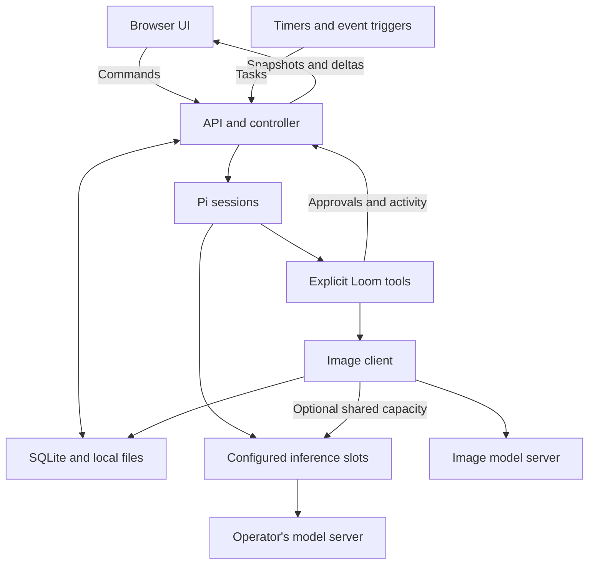

# Agent Loom architecture

This document describes version 0.1.3. [RESEARCH.md](RESEARCH.md) explains the upstream references; [API.md](API.md) describes the browser-facing endpoints and [MODELS.md](MODELS.md) covers configuration.

## Process boundaries

Loom runs as one Node.js process with a React browser client. The operator supplies the inference server. The production process serves the built frontend and API on the same origin; development uses Vite and an API proxy.

Inference slots cover individual model requests, including context compaction and, by default, image generation. They do not cover entire tasks. A session awaiting an ordinary tool or approval leaves model capacity available to another bot. The application data directory identifies one Loom instance; room working folders are separate execution settings, not separately switchable app instances.

## Code ownership

| Area                    | Main files                                                    | Responsibility                                                                                                                     |
| ----------------------- | ------------------------------------------------------------- | ---------------------------------------------------------------------------------------------------------------------------------- |
| Browser                 | `src/client/`                                                 | Rooms, chat composition, mentions, activity, approvals, bots, automation, learning, inbox, settings, and English/Japanese display. |
| Shared contract         | `src/shared/types.ts`, `model-limits.ts`, `model-settings.ts` | Serializable entities, event shapes, token bounds, reasoning values and default model settings.                                    |
| HTTP process            | `src/server/index.ts`, `app.ts`                               | Listening address, authentication, same-origin checks, static files, SSE, startup and shutdown.                                    |
| Application state       | `src/server/controller.ts`                                    | Durable task identities, room membership, status transitions, approval resolution, memory/skill records, and UI events.            |
| Routes and integrations | `src/server/routes.ts`, `integrations.ts`                     | Validated CRUD, model discovery, settings, webhook authentication, and automation configuration.                                   |
| Store                   | `src/server/store.ts`                                         | SQLite objects, encrypted secrets, deduplication records, initial data, and encryption-key storage.                                |
| Agent runtime           | `src/server/runtime/index.ts`                                 | Pi embedding, bot-by-room sessions, model provider configuration, streaming, usage, compaction, cancellation, and learning tasks.  |
| Inference queue         | `src/server/runtime/gate.ts`                                  | Abortable 1–16-slot admission, live capacity changes, per-room response admission and foreground priority.                         |
| Image generation        | `src/server/runtime/images.ts`                                | Separate image-model requests, bounded raster outputs, persistent attachments and safe image-file reads.                           |
| Tools                   | `src/server/runtime/tools.ts`                                 | Deliberate tool registry, permission checks, operation journal, handoff limits, and notifications.                                 |
| Automatic approval      | `src/server/runtime/approval-policy.ts`                       | Deterministic exact-operation rules and bounded built-in inspection equivalents.                                                   |
| I/O boundaries          | `src/server/runtime/network.ts`, `workspace.ts`               | Bounded network responses, public-address checks, text extraction, workspace file resolution, and file limits.                     |
| Scheduler               | `src/server/scheduler.ts`                                     | Interval checks, URL baselines, IMAP cursors, persisted/coalesced webhook events, and per-rule overlap prevention.                 |

## State and event delivery

SQLite is the source of truth for application records. The initial schema uses a typed object collection (`kind`, `id`, JSON `data`), plus tables for encrypted secrets, deduplication, and event records. SQLite runs in WAL mode. Pi's own session transcripts live in separate files under the same data directory.

The store obtains a connection-lifetime exclusive database lock before schema setup, seeding, or controller recovery. A second owner of the same directory fails before it can mark live tasks interrupted or cancel approvals. The operating system releases the lock when the owning process exits, including a crash.

`GET /api/state` returns a complete snapshot. Server-sent events send incremental answer text, separate provider-reported reasoning, persisted message patches, and fresh snapshots. The controller coalesces snapshot notifications over an 80 ms window; a reconnected client receives a current snapshot rather than trying to reconstruct truth from a missing browser tab. Room IDs and membership are database records. The selected room, drafts, and display preferences can remain in browser storage.

The current version returns unpaginated snapshots and retains history. It is intended for a small personal workspace, not a large deployment with many simultaneous users or an unlimited audit archive. Pagination, retention controls, and explicit migration tooling are future scaling work. There is no browser-side inference or authoritative browser-only task queue.

## Model requests and sessions

The runtime registers the configured endpoint with Pi as an OpenAI-compatible chat-completion provider. The initial adapter is text-only and uses streaming responses. Credentials remain in the backend. Pi's model catalog does not automatically fetch cloud catalogs, and Loom does not discover arbitrary CLI extensions or workspace instruction files.

Model token bounds live in `src/shared/model-limits.ts` and are used by the settings schema and selectors. The UI offers powers of two while retaining arbitrary saved values; the API continues to accept in-range integers. Maximum output must be strictly smaller than context. Selecting a value does not reconfigure the external inference server.

Reasoning defaults to the server's own behavior and omits `reasoning_effort`. Explicit mode sends one of `none`, `minimal`, `low`, `medium`, `high`, `xhigh`, `max`, or `ultra` literally. `reasoning.ts` supplies Pi with a provider thinking-level map, including `off → none` and the selected `max` or `ultra` mapping, so SDK normalization does not silently reduce a selected effort. These are configurable request values, not a claim that every model supports every level. Unsupported extensions such as `ultra` can be rejected by the server.

Pi's actual non-redacted thinking deltas are persisted and streamed into a separate message field, capped at 64,000 characters with explicit truncation and completion/interruption state. Loom does not synthesize reasoning for models that omit it. Intermediate assistant updates before tool calls are preserved in the activity timeline so the answer field can contain the eventual answer separately.

Saved model credentials are reused only within the saved URL origin. Connection tests against another origin require an explicitly supplied credential; changing the saved origin clears an omitted key. The settings route compares normalized values before blocking execution-sensitive edits during active work, so submitting an unchanged model/workspace alongside a permission or learning change is allowed.

A separate Pi session directory is selected for each **bot × room** pair. Several bots may share the same model but keep distinct session transcripts and instructions. The current room's recent completed public messages are supplied as bounded context; partially streaming and error messages are excluded. The `room_context` tool follows that completed-message rule too. Concurrent peers do not automatically consume one another's live fragments. Shared memories and that bot's own memories are included; other bots' private session transcripts are not copied into the prompt.

The global gate accepts `Settings.inference.maxConcurrentRequests` from 1 to 16, defaulting to 1. Capacity changes apply live: increasing admits eligible waiters, while decreasing leaves active requests running and drains to the new limit. Queue `active` can therefore temporarily exceed `capacity` after a reduction. Waiting work is FIFO among eligible foreground requests; learning takes spare capacity and does not preempt running work. A room awaiting its own turn does not block an independent eligible room.

`Room.parallelResponses` defaults to false. In that mode, the gate admits at most one response request in the room at a time. True allows distinct bot sessions in that room to share available global slots. This is a per-request room rule; it does not lock the whole room while a bot awaits a tool, approval, or another model turn. Tool operations from different bot tasks can overlap and room folders are not filesystem transaction locks.

A second queue above the inference gate keeps a bot × room session exclusive while allowing up to 16 tasks to reach a model/tool boundary. The same session is never entered concurrently, even in a parallel room. The queue exposes capacity, model/session wait counts and per-task reasons (`inference`, `room`, `session`, `worker`) for the UI. Tool and approval waits remain separate task states. The task queue is bounded to 200 active/queued tasks. A normal task is bounded to 30 model requests and 40 tool calls; a learning task gets at most six model requests. These are termination limits, not a task-success guarantee.

The gate submits separate HTTP requests. The external inference engine owns continuous batching, prefill/decode interleaving, KV-cache management and GPU execution. App-level concurrency makes simultaneous requests possible; it does not assert an engine optimization or guarantee a latency gain.

## Image generation and attachments

`generate_image` uses the independently configured Images endpoint, model ID and encrypted `image.apiKey`. It posts one prompt and size to `/images/generations` using the OpenAI-compatible Images protocol. Auto response format omits the legacy field; explicit Base64 sends `response_format: b64_json`. Native ComfyUI workflow APIs are outside this adapter.

The tool follows the network permission and operation journal. Auto requests manual review of generation rather than treating it as a safe web read. Approval happens before an image request reserves inference capacity. A per-host semaphore permits one image generation at a time. With `shareInferenceSlot` true, an image also acquires the global gate with its task/room context; false permits image/text overlap without taking a text slot. A change to Deny while it waits prevents submission. Stopping releases local queues and aborts I/O; the image server may still finish work it already accepted.

Outputs may be base64 data or an image URL. POST redirects are rejected rather than replaying generation. Same-origin image downloads may access the configured private server; other origins must resolve to public addresses. DNS is pinned, redirects and response bytes are bounded, and API keys are not forwarded to another origin. The client validates PNG/JPEG/WebP signatures and dimensions, rejects SVG, and caps each image at 20 MiB.

Images are stored with exclusive creation under `generated-images` inside the app data directory. They are not written into arbitrary room paths. Metadata is attached to the generating task's current message and indexed as `images` records; startup repairs the attachment index. `GET /api/images/:id` reads only validated app-managed files with authentication, `nosniff`, and private/no-store caching. Download mode adds an attachment disposition. Symlink paths and changed file sizes/media types are rejected.

A completed journal result contains image metadata. Repeating that exact tool operation after resume restores the attachment to the new message without regenerating it. Started/failed records block automatic replay because the remote outcome may be uncertain. Model context receives metadata, not image pixels or provider download URLs; the text adapter cannot claim visual inspection or certify image quality. Backups must include generated image files with the database and key.

## Room workspaces and native selection

`Room.workspacePath` optionally overrides `Settings.workspacePath`. The controller pins the effective folder on `Task.workspacePath` at queue admission. Handoff and learning tasks inherit the parent's folder; independent automatic tasks resolve their destination room. Legacy tasks are pinned at startup and before path-setting changes. Runtime copies of settings substitute the pinned root before constructing tools, prompts, and Pi sessions. Pi's recent-session selection filters transcripts by working directory within the bot × room directory.

Room-folder changes require that room to have no active tasks. Resume compares the pinned root with the current room root and refuses a mismatch, preventing a side-effect journal from being reused against a different directory.

`src/server/native-folder.ts` owns native chooser processes. Its API uses existing authentication/same-origin checks and additionally requires unforwarded loopback access through a loopback host. The dialog opens on the Node host, not a remote browser's computer. Paths are passed as data to static native programs. Only one chooser is active at a time; cancellation, timeout, and shutdown clean up the process. Results must be absolute existing directories. The UI saves the selected path only when the owner saves the form.

Windows uses the Common Item Dialog in folder mode via PowerShell; macOS uses `osascript`; Linux uses an available `zenity` or `kdialog` in a desktop session. Unsupported, headless, and remote installations expose an unavailable state and an explicit server-path fallback.

## Task states and recovery

| State               | Meaning                                                                       |
| ------------------- | ----------------------------------------------------------------------------- |
| `queued`            | Accepted and recorded; waiting for a session/runtime slot.                    |
| `waiting_model`     | Waiting for inference capacity or the room's response turn.                   |
| `running`           | The agent is generating or advancing its loop.                                |
| `waiting_tool`      | A tool is executing or waiting for its own resource, such as the image queue. |
| `awaiting_approval` | An exact proposed operation is waiting for the owner.                         |
| `completed`         | This task's agent loop completed.                                             |
| `stopped`           | The owner or orderly shutdown cancelled execution.                            |
| `interrupted`       | Work was found active after restart or never started before shutdown.         |
| `failed`            | The runtime reported an error that needs inspection.                          |

Only stopped, interrupted, or failed tasks can be resumed explicitly. The existing task ID is retained. Startup converts formerly active tasks to interrupted, cancels stale approvals, and marks unfinished message/activity records accordingly. Saved conversations remain available regardless of execution state.

Side-effecting tools journal a key derived from the task ID, tool name, and canonical arguments. A completed exact operation returns its saved result on replay. An operation recorded as started or failed is refused on automatic retry because its external outcome may be uncertain. The owner can inspect the target and start a new task when another attempt is appropriate.

This prevents a particular class of accidental repeats; it is not a distributed exactly-once protocol. A semantically similar command with different arguments has a different key, a stopped external process may already have produced effects, and an external service may have completed work just before a crash. Recovery must preserve and expose those limits.

## Approval and I/O boundaries

Shell, file writes, and network access each have Allow, Smart auto-approve (`auto`), Ask, or Deny policies. Defaults remain Ask for shell/file writes and Allow for network. A tool reads the current permission when it requests an operation. Ask records the bot, room, task, tool name, description, target, and exact arguments. The UI renders those details. The decision applies to that operation; a pending approval is cancelled on stop or restart and expires after one hour.

Auto uses deterministic rules for the exact operation, without another model request:

| Operation            | Automatic rule                                                                                                                                                                                                              |
| -------------------- | --------------------------------------------------------------------------------------------------------------------------------------------------------------------------------------------------------------------------- |
| New document         | `.md`, `.txt`, `.csv`, or `.tsv`; at most 64 KiB; inside the workspace; no hidden/private paths or existing target. Commit uses an atomic create-only operation, so a file appearing after the check cannot be overwritten. |
| Public web read      | HTTP(S) without embedded credentials or credential-like query parameter names. Existing public-address checks still apply to DNS resolution and redirects.                                                                  |
| Configured search    | Uses the owner's selected search integration.                                                                                                                                                                               |
| Workspace inspection | Exact `pwd`, `Get-Location`, `ls`, `ls -a`, `ls -l`, `ls -la`, `ls -al`, `dir`, `Get-ChildItem`, `Get-ChildItem -Name`, `node --version`, or `node -v`. Bounded built-in equivalents run without spawning a shell.          |

Arguments containing a known model/image/search secret do not receive automatic approval. Existing-file overwrites, scripts/code, image generation, and every other shell command request manual review. An automatic decision persists its rule identifier in `Activity.approvalRule`, with the reason and operation details visible in activity. These rules reduce repeated prompts within explicit categories; they do not establish the safety of arbitrary generated content.

Known-secret checks inspect actual string values and decoded URL components rather than a serialized JSON representation. Automatic web reads reapply their URL rules before following redirects. A redirect requiring review is stopped before contacting its destination; the owner can retry with network permission set to Ask. These checks are conservative rules, not a general data-loss-prevention system.

Built-in file tools resolve paths inside the configured workspace, reject selected credential/application paths and symlink escapes, and bound text sizes. General web fetches accept public HTTP(S) destinations, validate resolved addresses and redirects, and pin DNS lookup results for the request. Configured local language/image models and SearXNG are deliberate exceptions to the public-web boundary. SearXNG and credential-bearing search calls reject cross-origin redirects.

Shell commands execute with the operating-system user's permissions. They can access files and networks outside the workspace boundary of the file tools. Their output and execution time are bounded and cancellation is attempted, but an approval card does not create an OS sandbox. The [security policy](../SECURITY.md) states the supported deployment assumptions.

## Bot-to-bot collaboration

`send_message` targets an enabled member of the current room by short handle. It records a public handoff message and creates a child task tied to the same root task. Self-handoffs, cross-room handoffs, excessive depth, and excessive total handoff count are rejected. The configurable initial budget is six handoffs.

The sending tool returns a queued-task receipt; it does not synchronously wait for another model answer. The recipient's answer appears in the room. Another handoff can explicitly return a concrete question or result to the first bot. Ordinary bot messages do not automatically wake every other room member, and completion does not automatically create a new synthesis task. The handoff limits apply with both serial and parallel inference and prevent acknowledgement loops.

## Proactive execution

The scheduler scans due rules every five seconds without occupying model capacity. Per-rule jobs do not overlap. Before a new trigger creates work, the scheduler checks the previous task recorded in `automationState`; if it remains active, polling is deferred to a later interval. All triggered tasks go through the same controller, target validation, runtime queue, and tool permissions as chat tasks.

- **Interval:** the next due time is persisted. The minimum is one minute. A restart coalesces missed intervals rather than replaying a historical backlog.
- **URL watcher:** the first successful fetch establishes a source/hash baseline. Later changes in bounded, extracted readable text queue a task containing the current excerpt. This is not a browser renderer or an arbitrary page-diff engine.
- **IMAP:** a read-only mailbox selection records UIDVALIDITY and a UID cursor. The first check does not process old mail. Later checks fetch at most 20 new envelopes/dates, retain the remaining cursor, and never request bodies, attachments, flag changes, or sending. A UIDVALIDITY change creates a new baseline and notification.
- **Webhook:** the HTTP route authenticates a rule-specific token. Nonempty event IDs are persisted for deduplication. While the previous task is active, the newest 20 events are stored for a later batch; event text is capped at 1,000 characters, and overflow is reported as coalesced. Pending batches survive restarts. This is a bounded trigger buffer, not a lossless event bus.

URL and IMAP polling require network permission **Allow** or **Auto**. Auto permits the watcher's configured public URL read and read-only IMAP transport. Ask or Deny produces an automation error; unattended polling does not silently grant itself permission. Errors are visible in rule records and repeated identical failures do not generate an inbox notification on every poll. Shutdown aborts in-flight transports and stops timers.

Source edits invalidate source-specific hashes or mailbox cursors while retaining the prior task ID, so editing a rule cannot bypass its overlap guard. Disabling an assigned bot, removing it from the destination room, or archiving that room pauses affected enabled rules. Re-enabling a valid rule is an explicit owner action.

The app server must stay running for any of these triggers to work. The notification tool writes to the application inbox. External messaging platforms, mobile push, and provider-specific mail OAuth are not implemented in this version.

## Memory and learning

Memory is a concise fact or preference; a skill is a reusable procedure. Both can be scoped to one bot or shared. Bots can write their own memories and propose skill candidates. Only the owner-facing API activates a skill. The prompt lists active skill metadata; the bot uses `read_skill` to retrieve relevant instructions. A use count records reads, not successful outcomes.

With automatic learning enabled, a completed root task can queue a separate review when it used at least two tools and produced a substantive answer. The review gets bounded task/tool evidence, an isolated session, lower queue priority, and only memory/skill tools. It cannot use the normal shell, web, handoff, or notification tools. The review is instructed to prefer no change over unsupported or redundant lessons. Skill candidates retain the source task and evidence; user edits and restores retain revisions.

This is experience retention, not weight training. Memory writes can still be incorrect, and a convincing skill is not necessarily a correct procedure. The UI supports inspection and correction; the research document proposes outcome-based evaluation rather than treating skill count as a quality score.

## Credentials and deployment

The native server defaults to loopback. Binding elsewhere requires an application token of at least 24 characters. The browser exchanges it for an HttpOnly, SameSite cookie; API clients can use Bearer authentication. API snapshots expose only whether language-model/image/search/mail secrets are configured. Language and image keys are encrypted separately; changing an integration's origin clears its omitted saved key. Same-origin checks and local-mode Host checks restrict browser requests; these measures do not turn the app into a multi-tenant service.

Sessions are bound to the current access-token fingerprint, so rotating that token invalidates old cookies. Event streams recheck authentication before sending and close when their session is revoked; logout also closes streams associated with the revoked session.

Stored integration secrets use AES-256-GCM, with the encryption key stored as `secret.key` alongside SQLite. The full directory, including `generated-images`, must be backed up and protected. General conversation/task records, generated images and Pi session transcripts are not encrypted by Loom. A compromise of the process account or both database and key defeats this local encryption boundary.

The supplied Docker image runs as a non-root user, persists `/app/data`, and is published on host loopback by Compose. Docker provides a deployment boundary only to the extent its mounts, networks, and host permissions are configured appropriately. It does not provide separate sandboxes for individual bots.

## Validation boundary

The test suite uses temporary stores, deterministic model/transport fixtures, and local application requests. It covers consequential state, queue, approval, recovery, path/network checks, automation baselines, webhook deduplication/coalescing, and IMAP envelope limits. The repository includes cross-platform CI and a container build/health workflow.

Those tests establish application behavior under their fixtures. They do not measure the accuracy of a local model, authenticate to a real mailbox, certify an inference server's tool-call template, or establish long-term learning gains. Verify the actual model/server combination with a small conversation and tool task before depending on more complex workflows.
