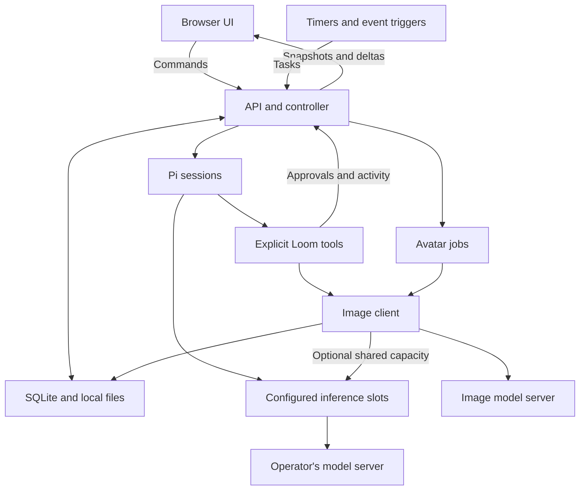

# Agent Loom architecture

This document describes version 0.10.0. [RESEARCH.md](RESEARCH.md) explains the upstream references; [API.md](API.md) describes the browser-facing endpoints and [MODELS.md](MODELS.md) covers model configuration. [MAIL.md](MAIL.md) covers external mail connections and service identities.

## Process boundaries

Loom runs as one Node.js process with a React browser client. The operator supplies the inference server. The production process serves the built frontend and API on the same origin; development uses Vite and an API proxy.

Inference slots cover individual model requests, including context compaction and image generation configured to share text-model capacity. They do not cover entire tasks. A session awaiting an ordinary tool or approval leaves model capacity available to another bot. The application data directory identifies one Loom instance; room working folders are separate execution settings, not separately switchable app instances.

## Code ownership

| Area                    | Main files                                                                                                             | Responsibility                                                                                                                                             |
| ----------------------- | ---------------------------------------------------------------------------------------------------------------------- | ---------------------------------------------------------------------------------------------------------------------------------------------------------- |
| Browser                 | `src/client/`                                                                                                          | Rooms, chat, approvals, bots, automations, mail/service accounts, learning, notifications, settings, and English/Japanese display.                         |
| Shared contract         | `src/shared/types.ts`, `model-limits.ts`, `model-settings.ts`, `avatars.ts`, `mail-accounts.ts`, `service-accounts.ts` | Serializable entities, event shapes, token bounds, reasoning values, model defaults, allowed avatar sources, and provider-neutral account/draft contracts. |
| HTTP process            | `src/server/index.ts`, `app.ts`                                                                                        | Listening address, authentication, same-origin checks, static files, SSE, startup and shutdown.                                                            |
| Application state       | `src/server/controller.ts`                                                                                             | Durable task identities, room membership, status transitions, approval resolution, memory/skill records, and UI events.                                    |
| Routes and integrations | `src/server/routes.ts`, `account-routes.ts`, `integrations.ts`                                                         | Validated CRUD, model discovery, settings, webhook authentication, mail/service endpoints, and automation configuration.                                   |
| Store                   | `src/server/store.ts`                                                                                                  | SQLite objects, encrypted secrets, deduplication records, initial data, and encryption-key storage.                                                        |
| Agent runtime           | `src/server/runtime/index.ts`                                                                                          | Pi embedding, bot-by-room sessions, model provider configuration, streaming, usage, compaction, cancellation, and learning tasks.                          |
| Inference queue         | `src/server/runtime/gate.ts`                                                                                           | Abortable 1–16-slot admission, live capacity changes, per-room response admission and fair work-group scheduling.                                          |
| Image generation        | `src/server/runtime/images.ts`                                                                                         | Separate image-model requests, bounded raster outputs, persistent attachments and safe image-file reads.                                                   |
| Image viewing           | `src/server/runtime/image-view.ts`, `image-budget.ts`                                                                  | Current-room/workspace image reads, checked file boundaries and the shared per-execution image-input byte budget.                                          |
| Avatar jobs             | `src/server/avatar-generations.ts`                                                                                     | Durable UUID requests, direct user consent, progress/cancellation, replay prevention and restart recovery.                                                 |
| Tools                   | `src/server/runtime/tools.ts`, `mail-tools.ts`                                                                         | Deliberate tool registry, permission checks, operation journal, handoff limits, and notifications.                                                         |
| Automatic approval      | `src/server/runtime/approval-policy.ts`                                                                                | Deterministic exact-operation rules and bounded built-in inspection equivalents.                                                                           |
| I/O boundaries          | `src/server/runtime/network.ts`, `workspace.ts`                                                                        | Bounded network responses, public-address checks, text extraction, workspace file resolution, and file limits.                                             |
| Scheduler               | `src/server/scheduler.ts`, `src/shared/schedules.ts`                                                                   | Calendar wake-ups, interval checks, URL baselines, provider mail cursors/pending queues, buffered webhooks, and per-rule task overlap prevention.          |
| Autonomous work         | `src/server/work.ts`, `src/shared/work.ts`, `src/server/runtime/wake-tools.ts`                                         | Owner room policy, durable purpose/checkpoint/run identities, scoped reservations, admission limits, lifecycle and recovery.                               |
| Mail account service    | `src/server/mail-accounts.ts`, `mail-providers/`                                                                       | Scoped external transport, bounded reads, exact draft revisions and durable send receipts.                                                                 |
| Account migration       | `src/server/mail-account-migration.ts`                                                                                 | Idempotent legacy IMAP migration with preserved UID cursors and no network calls.                                                                          |
| Service registry        | `src/server/service-accounts.ts`                                                                                       | Independent service identity metadata, encrypted credentials and explicit owner retrieval.                                                                 |

## State and event delivery

SQLite is the source of truth for application records. The initial schema uses a typed object collection (`kind`, `id`, JSON `data`), plus tables for encrypted secrets, deduplication, and event records. SQLite runs in WAL mode. Pi's own session transcripts live in separate files under the same data directory.

The store obtains a connection-lifetime exclusive database lock before schema setup, seeding, or controller recovery. A second owner of the same directory fails before it can mark live tasks interrupted or cancel approvals. The operating system releases the lock when the owning process exits, including a crash.

`GET /api/state` returns a complete snapshot. Server-sent events send incremental answer text, separate provider-reported reasoning, persisted message patches, and fresh snapshots. The controller coalesces snapshot notifications over an 80 ms window; a reconnected client receives a current snapshot rather than trying to reconstruct truth from a missing browser tab. Room IDs and membership are database records. The selected room, chat drafts, and display preferences can remain in browser storage. Mail drafts and send receipts are server-side SQLite records. Account snapshots expose safe metadata and configured-secret indicators, not stored credential values.

The current version returns unpaginated snapshots and retains history. It is intended for a small personal workspace, not a large deployment with many simultaneous users or an unlimited audit archive. Pagination, retention controls, and explicit migration tooling are future scaling work. There is no browser-side inference or authoritative browser-only task queue.

### Task state presentation and approval attention

`src/client/task-status.ts` derives a display phase from the authoritative task status, current queue reason, latest bot-run message, pending approvals and live connection. `waiting_model` is admission waiting in this runtime; it is not presented as an actively generating model. An active `running` task can show preparation, reasoning or answer generation using current streamed content. Terminal task status always wins over stale message flags. Lost connectivity marks nonterminal work unconfirmed without inferring failure or cancellation.

Chat initially renders the latest 100 room messages. A failed, stopped or interrupted task with an earlier task-output message stays at that message's original position in history; pagination must not append its card below the latest conversation. Loading earlier messages or explicitly navigating to the task reveals that record. Active tasks whose output is outside the visible window retain their standalone progress and approval controls. A resumable task with no task-output message in the room also retains a standalone card. Directed tool posts do not count as task-output messages. This presentation rule does not resume, stop or delete tasks, messages or operation receipts.

`RoomActivity` sits outside the message scroll container above the composer. It prioritizes a bot's pending/active task over settled history, retains distinct terminal states, and opens existing exact approval cards in the established modal component. Room membership and live task/approval ownership determine which bots appear. Review lists are scoped to a keyed room and sorted oldest first; inline cards retain their original run ownership. `ApprovalCard` shares a small in-flight decision store across its inline and dialog copies so a user cannot concurrently submit the same pending request from both.

App-level room badges, cross-room navigation and document-title counts expose approvals that the selected conversation does not contain. These UI additions do not alter permission decisions, task scheduling or tool execution. Only explicit task navigation changes reading position; new approvals and output preserve an upward-scrolled conversation. The client uses state transitions and connection evidence rather than percentage estimates or silence-based failure timers.

## Model requests and sessions

The runtime registers the configured endpoint with Pi as an OpenAI-compatible chat-completion provider using streaming responses. The provider declares `['text', 'image']` input when effective `model.imageInput` is enabled and `['text']` otherwise. This describes the owner's chosen capability and consent; it does not discover or add image support to the external model. Credentials remain in the backend. Pi's model catalog does not automatically fetch cloud catalogs, and Loom does not discover arbitrary CLI extensions or workspace instruction files.

`modelImageInputEnabled` in `src/shared/model-settings.ts` resolves the optional `model.imageInput` field. New installations explicitly default to false. Older settings without the field inherit `browser.includeScreenshotsInModel`, falling back to false, preserving the previous screenshot opt-in. Store responses normalize that effective value, and subsequent omitted updates retain it. An explicit model-wide choice takes precedence independently of Chrome enablement; the browser screenshot toggle then controls only immediate pixel inclusion on capture. Changes to effective model image input are execution-sensitive and use the model settings lock during active bot tasks, system-prompt jobs and avatar jobs.

Model token bounds live in `src/shared/model-limits.ts` and are used by the settings schema and selectors. Context supports 2,048–2,097,152 tokens and output supports 128–1,048,576. The UI offers powers of two while retaining arbitrary saved values; the API continues to accept in-range integers. Maximum output must be strictly smaller than context. Selecting a value does not reconfigure the external inference server or overwrite saved/default budgets.

Pi 1.5.2 compacts history when estimated context usage exceeds the context window minus its reserve. `model-context-budget.ts` derives the compaction input limit from an output reservation of at most half the context and the larger of a fixed allowance (up to 4,096 tokens, bounded by a quarter of small contexts) and 15% of estimated input. The gate respects smaller request-specific caps and refuses a request with no guarded output room. These estimates do not use a server-specific tokenizer; saved output settings are unchanged.

`reasoning-context.ts` prepares an immutable, budget-only transcript for Loom's text-only OpenAI-compatible transport. A positive, consistent reasoning breakdown can reduce only the latest valid same-model response's usage, and only when current provider projection proves that reasoning will not be resent. Branch evidence rejects compaction/context edits and changed input prefixes; cache reads and writes remain input. The known omission of `view_image` is applied to the reference tool catalog when image input is disabled. Image-enabled requests remain conservative because the saved catalog does not establish whether that tool was actually sent with the previous response. The estimate is the larger of corrected usage plus later messages and the projected message-size floor. The inference gate passes this temporary usage to Pi's own output clamp, while persisted response usage and task totals remain untouched. Unsupported compatibility, replay metadata and ambiguous counts fall back to the ordinary estimate.

`context-compaction.ts` supplies an internal `session_before_compact` extension. It merges the old summary and the removable turn prefix, then validates the projected candidate before Pi saves it. Comparison uses the same message-size basis for both contexts, with stale assistant usage excluded. The candidate includes system/tool state, the retained tail, and a pure preview of pending owner instructions; pre-prompt compaction also accounts for the upcoming prompt and pending changes to the live system prompt and tool declarations. A visible summary target, independent of the reasoning budget, must fit the remaining input allowance and substantially reduce the removed prefix. At most two complete candidates are generated, and `length`, abort, tool calls or empty summaries are rejected. Hook failure returns explicit cancellation and latches an error because Pi otherwise catches a thrown extension error and falls back to its own compactor.

Ordinary non-retry threshold checks can decline compaction when the corrected full input fits the same reserved budget. Manual compaction, overflow/truncation recovery and failed or aborted operations do not use this exception. The skip marker is consumed once and cleared on the next compaction or repair; it never clears a failure. A summary activity starts only immediately before generation, so Pi's cancellation event for a benign threshold skip does not appear as a user-visible failure. Before/after measurement projects proven omitted reasoning before discarding historical usage. An unchanged upcoming prompt/tool preview preserves the newest real system-update timestamp; an actual loadout change invalidates the prior usage anchor.

Before a new prompt, an existing summary exceeding a quarter of the input allowance, or causing the projected input to exceed that allowance, can be recompressed on its own. Summary-only repair appends a compaction entry using the original retained boundary and refreshes the canonical projection. When new raw history is responsible for excess input, the public session compaction API invokes the same validation hook and advances its retained boundary instead. The target is at most an eighth of the input allowance to avoid repeatedly repairing near the trigger. Cancellation and a changed branch prevent saving. Both paths use the ordinary gated stream and leave original history intact; `details.loomCompaction` records only size/attempt metadata alongside existing file references. See [context/output behavior](MODELS.md#context-and-output-budgets).

Reasoning defaults to the server's own behavior and omits `reasoning_effort`. Explicit mode sends one of `none`, `minimal`, `low`, `medium`, `high`, `xhigh`, `max`, or `ultra` literally. `reasoning.ts` supplies Pi with a provider thinking-level map, including `off → none` and the selected `max` or `ultra` mapping, so SDK normalization does not silently reduce a selected effort. These are configurable request values, not a claim that every model supports every level. Unsupported extensions such as `ultra` can be rejected by the server.

Pi's actual non-redacted thinking deltas are persisted and streamed into a separate message field, capped at 64,000 characters with explicit truncation and completion/interruption state. Loom does not synthesize reasoning for models that omit it. Intermediate assistant updates before tool calls are preserved in the activity timeline so the answer field can contain the eventual answer separately.

The client reuses the shared `ReactMarkdown`/`remark-gfm` renderer for answers, reasoning, progress notes in both timelines, notification bodies and quoted notification bodies. It does not enable raw HTML or rewrite the saved source. Reasoning retains its independent bounded scroll region and follow-at-bottom state as deltas arrive. Notification title and outer-quote styles are scoped to their direct elements so they do not override Markdown headings or create nested scrolling quotes. Tool logs, diagnostics, exact approval arguments and native desktop notifications remain plain text.

Saved model credentials are reused only within the saved URL origin. Connection tests against another origin require an explicitly supplied credential; changing the saved origin clears an omitted key. The settings route compares normalized values before blocking execution-sensitive edits during active work, so submitting an unchanged model/workspace alongside a permission or learning change is allowed.

A separate Pi session directory is selected for each **bot × room** pair. Several bots may share the same model but keep distinct session transcripts and instructions. The current room's recent completed public messages are supplied as bounded context; partially streaming and error messages are excluded. The `room_context` tool follows that completed-message rule too. Included messages carry bounded image references (ID, filename and MIME type; the last eight attachments per message), not automatically loaded pixels. Concurrent peers do not automatically consume one another's live fragments. Active shared memories and that bot's own active memories are included when their room scope matches; other bots' private session transcripts are not copied into the prompt.

The global gate accepts `Settings.inference.maxConcurrentRequests` from 1 to 16, defaulting to 1. Capacity changes apply live: increasing admits eligible waiters, while decreasing leaves active requests running and drains to the new limit. Queue `active` can therefore temporarily exceed `capacity` after a reduction. Eligible requests share service by logical work group, using recent model-slot occupancy and waiting time. Temporary owner or bot grants can prefer a bounded number of admissions, followed by an ordinary fair turn when another group is ready. A room awaiting its own turn does not block an independent eligible room. Priority applies to admission; it does not cancel an issued model request or tool.

`Room.parallelResponses` defaults to false. In that mode, the gate admits at most one response request in the room at a time. True allows distinct bot sessions in that room to share available global slots. This is a per-request room rule; it does not lock the whole room while a bot awaits a tool, approval, or another model turn. Tool operations from different bot tasks can overlap and room folders are not filesystem transaction locks.

A second queue above the inference gate keeps a bot × room session exclusive while allowing up to 16 tasks to reach a model/tool boundary. Runtime admission and worker readmission consult the same work-group scheduler and skip blocked sessions/rooms. Tasks can lend their worker at a safe checkpoint when another ready job should run. Capacity waiters can re-evaluate their position without cancelling an issued operation. No worker or model slot is permanently reserved for a task class or for summaries. See [EXECUTION.md](EXECUTION.md) for temporary grants, group accounting and the limits of changing execution order.

`runtime/scheduling.ts` measures model-slot occupancy per logical Work (or originating task), with a one-second minimum admission charge, a five-minute exponential recent-service window and a five-minute debt cap. A group that has waited at least 30 seconds without model service can receive an aging turn. A model admission or release resets that group's aging clock, so fan-out does not create independent aging allowances. After two preferred admissions, another ready group receives an ordinary fair selection, including when every group has requested priority. These are scheduler accounting parameters, not task termination limits or response-time guarantees. Completed task accounts are discarded; bounded recent group history remains available to related continuations.

`server/scheduling.ts` owns the persisted priority grants and exact grant references. Consumed allowances are coalesced when tasks join Work, including consumption above a bot grant's one-request allowance. Work binding and grant inheritance use the same database transaction. Owner actions and the bot's self-scoped `request_priority` tool revalidate the current task, room, bot, workspace and Work state. The runtime consumes a preferred admission durably before issuing it; fair turns do not spend priority. Approval waiters and image-capacity waiters can lend workers while their underlying operation has not begun. Actual provider, image and tool I/O keeps its normal lifetime.

The same bot × room session remains owned by its task until completion, including while that task lends a worker. A queued manual request for that same session cannot preempt it. The queue exposes capacity, model/session wait counts and per-task reasons (`inference`, `room`, `session`, `worker`) for the UI. Tool and approval waits remain separate task states. The task queue is bounded to 200 active/queued tasks. A normal task is bounded to 300 model requests and 400 tool calls per execution; a learning task gets at most ten model requests and 40 tool calls. Context compaction uses the same model-request allowance. Explicitly resuming a failed or stopped task starts a new allowance; pausing and resuming a running room keeps its existing counters. These are execution termination limits, not a work-item lifetime or success guarantee.

The gate submits separate HTTP requests. The external inference engine owns continuous batching, prefill/decode interleaving, KV-cache management and GPU execution. App-level concurrency makes simultaneous requests possible; it does not assert an engine optimization or guarantee a latency gain.

`src/server/runtime/model-stream.ts` wraps each admitted language-model stream with a first-output budget and a rolling output-idle budget. Their defaults are 1,800 and 300 seconds, configured through the optional model settings. Timers begin only after inference admission. HTTP headers, role-only chunks and SSE keepalives do not end the first-output wait; text, reasoning or tool-call progress does. A scoped Undici transport avoids the independent native-fetch five-minute header/body limits without modifying the global dispatcher used by other integrations. A timeout aborts only that request, reports a failure with partial output retained, and cleans up transport before releasing its inference slot. Timeouts do not trigger an automatic retry.

Transport evidence is captured inside the scoped fetch before Pi reduces provider errors to text. The diagnostic retains only recognized timeout codes, HTTP 408/504 and monotonic elapsed request time. Response-body observation preserves pull backpressure and cancellation without teeing. For an actual HTTP 400 only, at most 64 KiB is retained until normal consumption finishes, then discarded after extracting numeric context-overflow evidence. Caller cancellation and Loom's own deadlines take precedence over transport evidence. Missing evidence stays unknown; the short SDK timeout message alone cannot establish a failed connection stage. The separate ten-second connection deadline remains unchanged.

The gate permits one pre-generation context-budget correction per task execution, separate from Pi's bounded compaction recovery. It requires a real context HTTP 400, no successful response admission or generated content, and no cancellation. Exact input counts can set the new ceiling; lower bounds or missing counts use a conservative reduction without claiming an exact measurement. The failed terminal event is held until the correction decision, completed tool results remain in the same transcript, and the replacement reacquires shared inference capacity. Server acceptance or generation marks projected owner instructions delivered; dispatch alone does not. A rejected request remains eligible for a newer owner instruction to supersede it. Error token counts are never added to actual usage.

## System-prompt draft jobs

`src/server/prompt-generations.ts` owns user-initiated prompt drafts. It snapshots the configured text model and credential, reserves the runtime's shared inference gate, and calls Pi's streaming OpenAI adapter with no tools or agent session. The request contains only the supplied name, role, instructions, locale, and optional existing prompt; it does not load room conversation, memories or files. The prompt asks for an editable role-specific instruction document and makes clear that application permissions, tools and schedules cannot be created by wording alone.

Each UUID identifies one durable request. Identical replay returns the same job; conflicting content returns 409. One helper job can be active at a time, output is bounded and persisted roughly every 150 ms, and the editor polls active jobs once a second. The helper cap is 4,096 tokens or the configured output limit if lower. Complete text must also fit 32,000 characters; empty, truncated, tool-call or unfinished output fails. A conservative input allowance rejects oversized contexts before admission. After queue admission the helper uses the same configured first-output and rolling output-idle budgets as chat, with no competing ten-minute total-duration deadline.

Closing the editor cancels its HTTP observers but leaves the server job running. Stop aborts its queued/active request and releases capacity. Shutdown and restart mark unsettled jobs interrupted without replay. Text-model and demo changes are blocked while generation is active. Partial and completed text are distinct from bot settings: the user reviews/edits a completed draft, applies it to local form state, and saves through ordinary bot POST/PATCH. Undo restores the editor's previous text. Recent results remain available independently of unsaved form edits.

`model.imageInput` and the complete image-generation configuration can change while every active task is queued in a durably paused room or confirmed suspended by the runtime; pause intent and queue display metadata alone cannot authorize a write. The save validates and persists synchronously without aborting parked continuations. Model dispatch refreshes image input after capacity admission, and tool boundaries replace the image configuration with a fresh current copy. Each prepared image tool call pins an immutable configuration and credential before approval, so an endpoint selected before pause cannot receive a newly saved credential or execute different reviewed arguments. Queued bot images still refresh sharing on resume and honor current enablement and permission before dispatch. Other language-model connection/execution settings keep their existing locks.

## Image generation and attachments

`generate_image` uses the independently configured Images endpoint, model ID and encrypted `image.apiKey`. It posts one prompt and size to `/images/generations` using the OpenAI-compatible Images protocol. Auto response format omits the legacy field; explicit Base64 sends `response_format: b64_json`. Native ComfyUI workflow APIs are outside this adapter.

`DEFAULT_IMAGE_SETTINGS` supplies square 2K (`2048x2048`), a 3,600-second timeout, independent image capacity (`shareInferenceSlot:false`), no saved sampling-step default (`steps:null`) and the initial step format `sd_cpp_extra_args` for new or missing image fields. Store normalization retains explicit saved values. `IMAGE_TIMEOUT_LIMITS` defines the common 10–86,400-second integer range; `IMAGE_STEP_LIMITS` defines Loom's 1–1,000 integer step range for settings, bot overrides, tests, UI and archive validation. Providers may impose narrower limits. The visible 2K/60-minute/parallel preset changes only size, timeout and shared-capacity choice in the settings draft; normal Save persists it.

Requests include the selected size, including literal `auto` when chosen. The saved sampling-step setting was added in v0.8.4; since v0.8.6, `generate_image({prompt,size?,steps?})` also accepts an optional per-call count. Resolution is explicit call count, then saved default, then server-managed steps when both are absent. A bot override does not modify settings or select a sending format. Image tests use draft counts and formats, and avatars use saved defaults, through the same adapter.

A resolved non-null step count uses exactly one owner-configured transport, including when the saved default is null: the stable-diffusion.cpp prompt extension `<sd_cpp_extra_args>{"sample_params":{"sample_steps":COUNT}}</sd_cpp_extra_args>`, or one top-level field named `steps`, `num_inference_steps` or `sample_steps`. The original prompt stays in approvals and image metadata. Explicit stable-diffusion.cpp counts reject existing extension tags before approval or dispatch. Resolved counts and formats are pinned with the prepared image request before approval and included in its operation key; later settings cannot change an already prepared request's approved count or format. Server-default calls omit both identity fields to preserve legacy completed-operation reuse. The adapter does not probe alternate formats or automatically retry rejected generations, and completed image operations are not automatically replayed.

The common image path uses Node HTTP(S) with one abort deadline beginning after its local queues grant capacity. That budget covers the generation POST, returned-image download and local persistence; no unrelated five-minute transport clock or LLM response timer spans the image tool. Settings tests expose the admitted deadline while browser request timeouts apply only to short job-control calls. Local queue waiting consumes no image budget, and failure never automatically resubmits the generation.

The bot tool resolves `images.permission` through `imageGenerationPermission`: `inherit` is the default for new and legacy settings, mapping network Auto/Ask to exact approval; explicit `allow`, `ask`, or `deny` controls bot image generation independently. Network Deny remains a ceiling for all choices. Owner-clicked image tests and avatar generation retain direct consent under the other network modes. Image permission can change during active work, while image connection edits require full suspension; changing to Allow does not automatically resolve a pending approval card.

The tool keeps the exact-operation journal, with approval before reserving image/inference capacity. A per-host semaphore permits one image generation at a time. With `shareInferenceSlot` true, an image also acquires the global gate with its task/room context; false permits image/text overlap without taking a text slot. This choice is independent of endpoint origin or physical GPU topology: verified same-machine coexistence can use independent image capacity with text concurrency still at one. The live effective policy is rechecked after both queues; a newly stricter policy prevents HTTP dispatch. Task cancellation releases local queues and aborts I/O; the image server may still finish work it already accepted.

Outputs may be base64 data or an image URL. POST redirects are rejected rather than replaying generation. Same-origin image downloads may access the configured private server; other origins must resolve to public addresses. DNS is pinned, redirects and response bytes are bounded, and API keys are not forwarded to another origin. The client validates PNG/JPEG/WebP signatures and dimensions, rejects SVG, and caps each image at 20 MiB.

Images are stored with exclusive creation under `generated-images` inside the app data directory. They are not written into arbitrary room paths. Tool-generated metadata is attached to the generating task's current message; avatar-job metadata is attached to its persisted job. Both index the raster as an `images` record, and startup repairs those indexes from the owning records. `GET /api/images/:id` reads only validated app-managed files with authentication, `nosniff`, and private/no-store caching. Download mode adds an attachment disposition. Symlink paths and changed file sizes/media types are rejected.

A completed journal result contains image metadata. Repeating that exact tool operation after resume restores the attachment to the new message without regenerating it. Started/failed records block automatic replay because the remote outcome may be uncertain. `generate_image` returns a textual receipt and image ID, not pixels or provider download URLs. An image-capable conversation model can explicitly call `view_image` to inspect the saved result; generation or metadata alone does not establish visual inspection. Backups must include generated image files with the database and key.

### Explicit image viewing

Ordinary bot tasks with general image input enabled receive `view_image`; learning runs do not. The tool accepts exactly one current-room attachment ID or workspace-relative path. Current-room attachments include images generated by the active task, images from other members and saved Chrome screenshots. The current message attachments are authoritative: knowing an ID from another room, the global image index or an avatar job does not grant access. The current-room reference and its metadata are checked again after reading. Completed-message context makes older IDs discoverable without automatically injecting all image history.

`src/server/runtime/image-view.ts` reuses `workspacePath` and the existing raster validator. Path arguments cannot be URLs, absolute paths, Windows drive/UNC paths or protected credential/application locations. Symlinks are accepted only when they resolve to an allowed workspace target. Managed images resolve from their validated ID and MIME extension rather than a display filename. The helper checks canonical paths, regular-file status, ancestor/file identities and file metadata around opening and reading, uses no-follow flags where supported, and rejects detected replacement or growth. Reads are bounded and cancellable. Each raster is limited to 20 MiB, 8,192 pixels per side and 16,777,216 pixels total. Signature and dimension-header checks are not full codec decoding, and files are not resized. These checks enforce the application's read boundary; they are not OS isolation against a process running with the owner's privileges.

The common tool wrapper passes a real Pi `{type:'image',data:<base64>,mimeType}` content block alongside the short textual source/type/byte-count receipt. Actual pixels therefore reach the configured conversation model through its normal provider adapter. No separate vision service, image-generation request, network fetch, file write or image-generation approval is involved. General image capability is checked against both pinned and current settings before and after the read. The tool participates in ordinary activity reporting, the 40-tool-call limit, room pause boundaries and combined task/tool cancellation. Image contents are explicitly treated as untrusted task data, and prompts require actual image content before a bot claims visual inspection.

`ImageInputBudget` is instantiated once per task execution and shared by `view_image` and capture-time Chrome screenshot inclusion. It reserves at most 80 MiB of newly emitted image data, measured as raw raster bytes, excluding base64 expansion, only after a successful read and final capability check. Re-reading an image consumes capacity again. The same live execution survives room pause/resume and compaction with its counter intact; explicitly restarting a stopped task creates a new tool registry and counter. Exhaustion prevents `view_image` from emitting pixels, while a screenshot remains a chat attachment and returns only metadata. This budget limits new tool output; it does not bound previously persisted history, retransmission across model turns, total HTTP request size or provider context usage.

Pi persists received image content in its bot-by-room session transcript and may retain or compact it as context evolves. Turning image input off prevents pixels from being sent in subsequent model requests, including earlier image blocks, but does not delete those session files or saved chat attachments. Turning it back on can make retained image context eligible again. A bot can explicitly reread a needed source after compaction, subject to the remaining execution budget.

### Character-avatar pipeline

`Bot.avatar` resolves through an allowlist of eight bundled character paths or an app-managed image identifier. Legacy icons and symbols remain supported. The shared resolver never treats arbitrary avatar text as a remote URL, filesystem path or markup. The store seeds character defaults and performs a one-time migration of the two original default icons, preserving customized avatars, deleted bots and later user selections.

The shared avatar component renders `Bot.color` as a visible accent frame around portrait images, including generated avatars, while retaining fixed outer dimensions. The profile editor previews color changes in its draft and saves them with the bot. Production smoke validation imports the compiled shared character catalog and checks every listed WebP asset through the HTTP server.

The profile editor submits a UUID and appearance prompt to `avatar-generations.ts`. That module persists a job before starting image work and reuses the same validated image client, serialized image gate, optional global inference gate and encrypted image credential as chat tools. It does not create a Pi session, bot task or room message. Only one avatar job can be active across the application. Generate is direct consent for that request; Network Deny still blocks admission or later dispatch. Image/text execution settings and credentials remain pinned while a job is active.

The editor observes persisted `queued`/`generating` state, previews a completed image, and lets the user select it before saving the bot. Closing the editor does not cancel generation. Reposting the same UUID and trimmed prompt returns the same job; changing the prompt under that UUID is rejected. Cancellation retains the job record, while shutdown or restart marks unfinished jobs interrupted. Terminal jobs are never replayed automatically; another deliberate attempt uses another UUID. The recent list exposes 20 jobs, with older records still retrievable by ID. This job protocol handles client/navigation recovery without claiming remote exactly-once execution. See [avatar API](API.md#avatar-generation-jobs) and [avatar usage/artwork](AVATARS.md).

## Room workspaces and native selection

`Room.workspacePath` optionally overrides `Settings.workspacePath`. The controller pins the effective folder on `Task.workspacePath` at queue admission. Handoff and learning tasks inherit the parent's folder; independent automatic tasks resolve their destination room. Legacy tasks are pinned at startup and before path-setting changes. Runtime copies of settings substitute the pinned root before constructing tools, prompts, and Pi sessions. Pi's recent-session selection filters transcripts by working directory within the bot × room directory.

Room-folder changes require that room to have no active tasks. Resume compares the pinned root with the current room root and refuses a mismatch, preventing a side-effect journal from being reused against a different directory.

`src/server/native-folder.ts` owns native chooser processes. Its API uses existing authentication/same-origin checks and additionally requires unforwarded loopback access through a loopback host. The dialog opens on the Node host, not a remote browser's computer. Paths are passed as data to static native programs. Only one chooser is active at a time; cancellation, timeout, and shutdown clean up the process. Results must be absolute existing directories. The UI saves the selected path only when the owner saves the form.

Windows uses the Common Item Dialog in folder mode via PowerShell; macOS uses `osascript`; Linux uses an available `zenity` or `kdialog` in a desktop session. Unsupported, headless, and remote installations expose an unavailable state and an explicit server-path fallback.

## Task states and recovery

`src/shared/task-interruption.ts` defines fixed cancellation messages for explicit owner stops and known application lifecycle causes. The runtime retains the initiating cause separately from `AbortSignal`, because an abort alone cannot establish who requested it. Explicit stop takes precedence over shutdown cleanup; the existing update checkpoint keeps its separate paused-queue behavior. `createApp.close(reason)` carries process signals, supervisor shutdown/disconnection and managed data-transfer causes to the runtime. Application admission closes before asynchronous service cleanup begins. Standard server logs include bounded `loom_started` and `loom_shutdown` events with a known reason and active-task count, without model URLs, credentials or provider-error objects.

| State               | Meaning                                                                       |
| ------------------- | ----------------------------------------------------------------------------- |
| `queued`            | Accepted and recorded; waiting for a session/runtime slot.                    |
| `waiting_model`     | Waiting for inference capacity or the room's response turn.                   |
| `running`           | The agent is generating or advancing its loop.                                |
| `waiting_tool`      | A tool is executing or waiting for its own resource, such as the image queue. |
| `awaiting_approval` | An exact proposed operation is waiting for the owner.                         |
| `completed`         | This task's agent loop completed.                                             |
| `stopped`           | An explicit owner task-stop request cancelled execution.                      |
| `interrupted`       | Shutdown, restart or unexpected cancellation interrupted execution.           |
| `failed`            | The runtime reported an error that needs inspection.                          |

Only stopped, interrupted, or failed tasks can be resumed explicitly. The existing task ID is retained. Startup converts formerly active tasks to interrupted, except queued work in a paused room, which remains held until room resume. It cancels stale approvals and marks unfinished message/activity records accordingly. Saved conversations remain available regardless of execution state. Queued cancellation is persisted before asynchronous runtime cleanup, and runtime admission rechecks durable status so a stale queue entry cannot revive cancelled work.

Side-effecting tools normally journal a key derived from the task ID, tool name, and canonical arguments. Work-linked continuations also resolve receipts by work, run, room and actual bot identity, so another task in the same occurrence can recover that bot's completed exact effect. Receipts recorded before the caller was bound to its work remain discoverable through that same actor's bound tasks. Existing receipt keys are immutable, including across workspace rebasing on import; live work/workspace checks prevent applying them in another execution scope.

Completed file, mail, image, browser and notification effects return their saved results for an exact replay within that scope. Completed shell commands remain task-local: a new continuation may need to rerun a test or inspection after files change. Started/failed shell receipts remain guarded across the work/run, just like other uncertain effects, so changing task identity does not turn an unknown execution into an automatic retry. Typed mail sends also retain their provider request IDs. Current tool permissions, account assignment and work state are rechecked before receipt access; a saved result grants no additional authority.

This prevents a particular class of accidental repeats; it is not a distributed exactly-once protocol. A semantically similar command with different arguments has a different key, a stopped external process may already have produced effects, and an external service may have completed work just before a crash. Recovery must preserve and expose those limits.

## Chrome adapter

`src/server/browser-manager.ts` routes trusted task bot IDs to an independent `BrowserControl` and persistent profile per dedicated bot, or to the legacy shared browser. Missing browser choices on old bots retain shared behavior; new bots default to dedicated. A bounded browser pool lazily starts connections and can suspend idle residents without deleting profiles. Once a task first uses a browser, a task-scoped lease retains it through model reasoning, tool execution and approvals until task completion/cancellation. Explicit disconnect and global disable/deny also cancel the relevant leases and approval waits. This keeps page state available between successive tool calls while permitting independent bots to operate concurrently.

`src/server/browser.ts` owns each serialized connection. It starts the pinned installed Chrome DevTools MCP child through the MCP SDK's stdio transport, with explicit fixed arguments and a minimal desktop environment. No shell command, runtime `npx` install or extra LLM loop is involved. Ordinary app startup and cached status reads do not connect. Existing Chrome uses Chrome's own consent flow; dedicated mode uses an app-owned persistent profile. Disconnect aborts queued work, closes the child, invalidates page states and pauses implicit reconnection.

The runtime exposes the deliberately limited `browser_use` tool only to ordinary enabled bot sessions, not learning runs. A synchronous preparation stage checks cached page state and creates a concrete approval request without browser I/O. After approval, the browser queue rechecks current permissions and connection identity, refreshes the page URL and relevant accessibility state, and consumes the snapshot before a mutation. Each browser's input queue and the global browser pool are separate from the inference gate. Shared-browser users remain serialized; distinct dedicated browsers can progress in parallel. Mutation receipts use the existing durable operation journal; stale/uncertain actions require inspection rather than automatic replay.

Loom control origins and loopback aliases on their ports are protected. HTTP(S) and `about:blank` are the supported navigation destinations. Page text is bounded and marked as untrusted; arbitrary evaluation, file navigation, network/header inspection and browser shortcuts are not exposed. This is an operation boundary for a trusted owner's browser, not process isolation or a guarantee against page changes after a check.

Viewport screenshots share the existing bounded raster validation and authenticated image store. Immediate pixel inclusion requires effective `model.imageInput` and `browser.includeScreenshotsInModel` in both pinned and current settings, plus remaining capacity in the shared per-execution image-input budget. Otherwise the tool returns attachment metadata and text-snapshot guidance while preserving DOM/snapshot control. With general image input enabled, a bot can later inspect a saved current-room screenshot through `view_image` even when automatic inclusion on capture is off. The browser toggle does not set the provider's general image capability once an explicit model choice exists. API/Settings status checks never consume model requests. The upstream adapter's usage statistics, CrUX, update checks and config discovery are disabled. See [browser setup](BROWSER.md).

## Approval and I/O boundaries

Shell, file writes, and network access each have Allow, Smart auto-approve (`auto`), Ask, or Deny policies. Defaults remain Ask for shell/file writes and Allow for network. A tool reads the current permission when it requests an operation. Ask records the bot, room, task, tool name, description, target, and exact arguments. The UI renders those details. The decision applies to that operation; a pending approval is cancelled on stop or restart and expires after one hour.

Auto uses deterministic rules for the exact operation, without another model request:

| Operation            | Automatic rule                                                                                                                                                                                                              |
| -------------------- | --------------------------------------------------------------------------------------------------------------------------------------------------------------------------------------------------------------------------- |
| New document         | `.md`, `.txt`, `.csv`, or `.tsv`; at most 64 KiB; inside the workspace; no hidden/private paths or existing target. Commit uses an atomic create-only operation, so a file appearing after the check cannot be overwritten. |
| Public web read      | HTTP(S) without embedded credentials or credential-like query parameter names. Existing public-address checks still apply to DNS resolution and redirects.                                                                  |
| Configured search    | Uses the owner's selected search integration.                                                                                                                                                                               |
| Assigned mail read   | `search_mail` and `read_mail` use an enabled account assigned to the bot, without changing flags or sending.                                                                                                                |
| Workspace inspection | Exact `pwd`, `Get-Location`, `ls`, `ls -a`, `ls -l`, `ls -la`, `ls -al`, `dir`, `Get-ChildItem`, `Get-ChildItem -Name`, `node --version`, or `node -v`. Bounded built-in equivalents run without spawning a shell.          |

The file, shell and general web automatic-approval rules reject arguments containing a known model/image/search secret. Mail read rules rely on account assignment and server-held credentials; sending has a separate per-account policy described below. Existing-file overwrites, scripts/code and every other shell command fall back to manual review under Auto. Bot image generation follows its independent image policy described above; read-only `view_image` does not request generation approval. User-initiated avatar jobs take the Generate action as consent for the displayed request. An automatic decision persists its rule identifier in `Activity.approvalRule`, with the reason and operation details visible in activity. These rules reduce repeated prompts within explicit categories; they do not establish the safety of arbitrary generated content.

Known-secret checks inspect actual string values and decoded URL components rather than a serialized JSON representation. Automatic web reads reapply their URL rules before following redirects. A redirect requiring review is stopped before contacting its destination; the owner can retry with network permission set to Ask. These checks are conservative rules, not a general data-loss-prevention system.

Built-in file tools resolve paths inside the configured workspace, reject selected credential/application paths and symlink escapes, and bound text sizes. General web fetches accept public HTTP(S) destinations, validate resolved addresses and redirects, and pin DNS lookup results for the request. Configured local language/image models and SearXNG are deliberate exceptions to the public-web boundary. SearXNG and credential-bearing search calls reject cross-origin redirects.

Shell commands execute with the operating-system user's permissions. They can access files and networks outside the workspace boundary of the file tools. Their output and execution time are bounded and cancellation is attempted, but an approval card does not create an OS sandbox. The [security policy](../SECURITY.md) states the supported deployment assumptions.

## Bot-to-bot collaboration

`send_message` targets an enabled member of the current room by short handle. It records a public handoff message and creates a child task tied to the same root task. Self-handoffs and cross-room handoffs are rejected. `maxHandoffs: null` is the new-install default and removes count/depth limits; `0` disables handoffs; a positive integer applies the same bound to total handoffs and depth. Saved finite/disabled settings are retained on upgrade, and API/import validation accepts the same finite range of 1–10,000.

The sending tool returns a queued-task receipt; it does not synchronously wait for another model answer. The recipient's answer appears in the room. Another handoff can explicitly return a concrete question or result to the first bot. Ordinary bot messages do not automatically wake every other room member, and completion does not automatically create a new synthesis task. Optional finite limits apply with both serial and parallel inference; unlimited mode retains concurrency and pending-queue limits, which do not bound a sequential chain's lifetime.

`Room.paused` is persisted before the pause response. The runtime excludes paused rooms from new task starts and checkpoints every tool call and provider request, including compaction. Issued operations finish; the next action suspends the existing Pi promise so completed tool results and pending same-batch calls do not need reconstruction or replay. Approval resolution also checkpoints before issuance. Pause signals cancel only capacity acquisition, never active I/O; raced grants are released before retrying admission.

`runtime/pause.ts` lends suspended workers to other rooms and reserves a worker before resolving each resumed continuation, keeping the same 16-worker bound. The bot × room session stays exclusive. Suspension releases idle browser residency; browser approval uses a profile lifetime signal so room pause preserves consent while explicit disconnect/denial still cancels it. A resumed browser interaction revalidates its original plan and fails safely if the page/session changed. Queue snapshots expose started continuations as paused or waiting for a worker.

Newly admitted manual requests and child tasks stay queued. Scheduler checks do not start in paused rooms; webhook/mail work and schedule missed-run policies are preserved for resumption. The pause flag and never-started queue survive shutdown/restart; started continuations require explicit recovery after restart. Individual task cancellation remains a separate immediate operation.

Web updates use a deliberate checkpoint for started work. `Runtime.isTaskSuspended` confirms both a paused room and a suspended registered worker; the durable task status or room flag alone cannot authorize restart. The update route retains its idle checks before and after remote verification and after closing admission/stopping the scheduler. Under maintenance, `prepareForUpdate` revalidates all started jobs, settles only those paused executions, waits for Pi transcripts and tool cleanup, then queues the same task IDs in their still-paused rooms. A final idle check precedes the launcher request. Ordinary generation, active tools, owner generation jobs, mail, transfers and in-flight API handlers still block installation. Direct task resume is guarded by maintenance and shutdown just like room resume and new-task admission.

The resulting queue survives a successful update or rollback, and a definitive launcher refusal leaves it available in the original process. Explicit room resume recovers from saved Pi context and operation receipts, with a resume hint in the task prompt. It does not restore a JavaScript continuation across a process restart. Pending approvals are cancelled and requested again when needed. Completed exact operations retain their receipts; started/failed records remain non-replayable, including a previously journaled image request that was parked while waiting for capacity. Those uncertain or unfinished operations still require inspection and an explicit new task when a retry is needed. Ordinary shutdown without this update checkpoint retains its existing explicit interrupted-task recovery behavior.

## Mail and external service identities

`MailService` runs in the application process independently of model admission. It separates the public `MailAccount` identity from encrypted IMAP, SMTP or API credentials and dispatches to the provider adapter. IMAP with optional SMTP, AgentMail v0 inboxes, and Resend Inboxes are implemented. Resend uses `/inboxes/...` rather than treating the separate send-only `/emails` API as a mailbox. Providers host the mail; Loom does not provision addresses, domains or servers.

Bot tools can list/read/search only enabled accounts assigned to their bot, with current room/bot checks and network permission. Incoming content is untrusted. Reads return bounded plain text and attachment metadata; IMAP message retrieval uses read-only EXAMINE and BODY.PEEK. For servers identified as Courier by their greeting, a bounded source-identity cache controls SELECT initialization followed by EXAMINE; both selections must agree on UIDVALIDITY before caching. The cache is only a compatibility hint: each connection verifies its own metadata, genuine namespace changes still invalidate old locators, and refused SELECT falls back to a fresh EXAMINE. SELECT can consume the transient Recent flag, but no STORE, EXPUNGE, move or delete operation is used. MIME source input is capped at 1,000,000 bytes, API responses at 2,000,000 bytes, and returned text at 65,536 characters. No attachment download or HTML resource loading is exposed. Search remains provider-specific and paginated.

Single-message IMAP reads drain each FETCH before issuing the next command and merge only responses with the requested UID. This avoids the pinned client's first-response-only `fetchOne()` behavior when unsolicited flag updates arrive before the requested data. Metadata and body retrieval both use the same UID check; a missing or foreign UID cannot supply the requested message. The adapter checks the advertised size before requesting a bounded BODY.PEEK source, then checks the returned bytes. Missing messages remain `not_found`; matching responses without usable size or body data return `message_fetch_failed`.

`src/server/runtime/mail-context.ts` projects a bounded, credential-free mail summary into the system prompt at each task start or explicit resume. It supplies current assigned identities, effective read/send policies and this bot's incoming-mail rule state in the current room. The projection reads only local configuration and replaces prior system context, avoiding an identity-discovery tool round trip without accumulating a new discovery message. Learning and unavailable actor states expose no identities. A snapshot does not establish connectivity or override live tool guards; `list_mail_accounts` remains available for explicit refresh and omitted accounts.

A `MailDraft` pins an account revision, sender, explicit To/Cc/Bcc, subject, text and optional reply locator. The bot's send tool combines the account's Ask/Allow/Deny policy with current network permission. Ask shows the exact complete content for owner review; Auto permits read operations but does not override account Ask. The adapter rechecks account revision, assignment, permission and cancellation before requests and before dispatch. A changed draft/account invalidates the reviewed send.

The send service records a UUID attempt before network submission. Its durable states are `sending`, `sent`, `failed` and `unknown`; the draft starts as `draft`. Accepted request replay returns its receipt, while failed and uncertain attempts are terminal. Provider acceptance is saved separately from the runtime operation journal, allowing a journal crash gap to recover without another send. Unsettled sends become unknown on restart. SMTP partial acceptance is treated as uncertain. A receipt proves only provider acceptance, not delivery or reading; SMTP does not append an IMAP Sent copy itself.

API connection tests verify existing inbox access and address identity without sending. SMTP verification connects/authenticates but cannot establish acceptance of a particular sender or recipient. Credentials and raw transport diagnostics are not returned to the model. TLS/STARTTLS, fixed API origins, bounded responses and cancellation are enforced by the adapters. The Gmail preset supplies IMAP and SMTP settings; grouping whitespace is normalized for its supported app-password transports. Provider-specific OAuth is not implemented.

The service registry is separate from mail transport. A `ServiceAccount` associates a service URL/login with an optional bot and mail account, local status and notes. An optional encrypted credential can be saved through owner routes and the dedicated `manage_service_account.credential` input; bot results contain only safe metadata and its configured indicator. Explicit service-editor Show/Copy actions use a dedicated POST endpoint with the reviewed revision, existing API authentication and Origin checks, and no-store caching. The value is never added to snapshots, SSE, operation receipts or bot results. UI values stay in short-lived component state and are invalidated on close, disconnect, saved-record changes and a one-minute timeout; stale async responses cannot repopulate a changed editor. Owner-approved bot changes can create or update their own registry records and save, replace or clear a credential. Approval arguments contain a value-free action, including identity-driven removal, and live actor/assignment/revision checks run at the actual write boundary. A per-run input guard withholds the dedicated credential before Pi validates or persists the assistant tool call, restores it only inside that call's execution, and discards it during cleanup. Missing or replayed input markers cannot become credentials. Activities and operation arguments omit the value; the operation journal uses an installation-keyed fingerprint to distinguish replacements across restart without a plaintext receipt. This does not remove secrets separately placed in ordinary messages or other public content. Records do not create external accounts, log in, establish OAuth sessions, attach browser profiles or inject stored credentials into Chrome. Removing a bot or mail connection detaches relevant references; external identities remain intact.

See [MAIL.md](MAIL.md) for setup, policy combinations, limits, migration and the provider extension contract.

## Proactive execution

### Owner-managed automation rules

`src/server/automations.ts` owns shared configuration validation, credential retention and source invalidation for the owner API and runtime host. Direct root chat tasks expose `list_automations` and `manage_automation`; scheduled tasks, learning runs and handoffs do not. The tools are restricted to their current room and enabled member handles. Creating interval, URL-watch, webhook or mail rules and changing existing ordinary records requires concrete owner approval, independent of shell/file/network permissions. Before persistence the tool revalidates its room, actor, target and reviewed configuration; a semantic revision rejects concurrent configuration edits while allowing scheduler timestamps to change. Mutations use the operation journal to avoid replay on resume. The tools never accept mail passwords or return webhook tokens. Connected mail rules select an account already assigned to their target bot; only legacy inline IMAP setup drafts remain disabled until credentials are entered in the owner editor.

New bot calendar creation belongs to autonomous work. The primary tools are `list_wakeups` and `manage_wakeup`; `manage_automation` with `operation:create` and `kind:schedule` adapts to the same `WorkService.manageWakeup` path without an approval request. It never writes an ordinary `Automation`. The current room policy, minimum lead time, pending-work limits and owner stop rules apply at execution. The adapter retains the task-local operation receipt and returns work/wake-up identities; completed legacy receipts are restored before adaptation. An already bound task retains its work and checkpoint, while a new binding starts assignment work for a once schedule or standing work for a recurrence. Existing ordinary records are not silently adopted as bot-owned work, and disabled calendar drafts require the owner editor.

For ordinary automation rules, the scheduler scans due rules every five seconds without occupying model capacity. Per-rule poll jobs do not overlap. Each rule checks the previous task recorded in `automationState` before admitting another task. Interval and URL checks defer while that task is active; mail intake continues and buffers new summaries independently of inference. All triggered tasks go through the same controller, target validation, runtime queue and tool permissions as chat tasks.

- **Calendar wake-up:** the `schedule` kind stores a discriminated once/daily/weekly specification, explicit IANA time zone and missed-run policy. `src/shared/schedules.ts` resolves local wall-clock times with bounded `Intl` offset probes and UTC round-trip validation. A one-time gap rejects input; recurring gaps skip the date; a fold uses its first occurrence. Task admission, previous-task identity, one-time consumption and next-occurrence advancement commit in one SQLite transaction. Controller startup uses a microtask which rechecks the committed task. A consumed one-time reservation stays disabled after restart. `run_once` retains one pending overdue occurrence while busy; `skip` advances when at least 60 seconds late. Admission errors preserve the occurrence and impose a retry delay. Title/prompt edits preserve pending times; calendar identity changes explicitly calculate a new next occurrence. See [SCHEDULES.md](SCHEDULES.md).
- **Interval:** the next due time is persisted. The minimum is one minute. A restart coalesces missed intervals rather than replaying a historical backlog.
- **URL watcher:** the first successful fetch establishes a source/hash baseline. Later changes in bounded, extracted readable text queue a task containing the current excerpt. This is not a browser renderer or an arbitrary page-diff engine.
- **Connected mail:** the compatible `imap` trigger kind uses `mailAccountId` to select any supported mail provider. Initial receipt filtering uses rule creation time, and retargeting uses source-edit time. First-baseline results can include arrivals after that cutoff and are processed. Polls retrieve at most 20 summaries; each rule persists at most 100 pending events. A full buffer stops polling without advancing the provider cursor. Overlap deduplication, pending events and cursor checkpoint commit in one transaction; creating a task and acknowledging its batch also commit together. Provider pagination continues across later checks rather than unboundedly draining the source in one request. Tasks receive envelope metadata and complete message locators, and can use `read_mail` when body content is needed. IMAP tracks UIDVALIDITY; a changed namespace establishes a fresh high-UID baseline rather than replaying old mail.
- **Legacy IMAP:** a rule without `mailAccountId` keeps its read-only UIDVALIDITY/high-UID baseline behavior. Its first check skips historical mail, then fetches bounded new envelopes/dates. New arrivals are buffered even while inference is busy. This path does not provide body reads or sending.
- **Webhook:** the HTTP route authenticates a rule-specific token. Nonempty event IDs are persisted for deduplication. While the previous task is active, the newest 20 events are stored for a later batch; event text is capped at 1,000 characters, and overflow is reported as coalesced. Pending batches survive restarts. This coalescing webhook buffer differs from mail's cursor-backed full-buffer behavior.

URL and mail polling require network permission **Allow** or **Auto**. Ask or Deny produces an automation error; unattended polling does not grant itself permission. Errors remain visible on the rule, repeated identical failures do not generate a notification on every poll, and shutdown aborts transports and stops timers. Polling follows the configured minute interval and provider pagination; these are not instantaneous push notifications.

Receive-source identity includes provider, address, receiving endpoint/account and folder or API inbox ID. Source edits invalidate source-specific cursors and pending events while retaining the prior task ID. In-flight results are revalidated before persistence. Name, credential, assignment and send-policy revisions do not themselves redefine the receive source. Disabling/unassigning mail, disabling a bot, removing it from the destination room or archiving that room pauses affected enabled rules. Re-enabling a valid rule is an explicit owner action.

Startup migration runs before runtime/scheduler construction and makes no network requests. Compatible legacy IMAP rules become receive-only accounts, with assignments and encrypted credentials retained. A `legacyMailAccountId` marker binds previously observed matching UID state to the migrated connection, surviving a rule edit before the first generic poll. The next successful generic checkpoint replaces that transitional state. A username that is not an email address stays on the legacy path rather than inventing a From address; SMTP configuration is never guessed.

The app server must stay running for these triggers. `notify_user` writes to the application notification inbox; external email uses the account mail tools. Mobile push and external messaging-platform bots are not implemented in this version.

Notification records distinguish an explicit bot sender from a system notice. The controller saves the actual bot's ID, name and handle, and `send_user_message` retains the message ID. Legacy task links can identify the responsible bot without inventing authorship from text. The shared notification resolver keeps UI availability and server routing consistent. Reply admission checks the current sender, room and model image setting. Image replies reuse chat validation and immutable file storage, with file I/O outside the transaction. After I/O, admission, original context, workspace and any concurrent receipt are checked again; failed or duplicate staging is discarded. Acceptance then atomically saves a user message with attachments, a new root task with matching input image IDs, read state and an idempotent receipt. The receipt uses an installation-keyed fingerprint covering text and ordered image bytes/metadata; legacy text-only receipts remain valid. Runtime dispatch occurs through the existing microtask that rechecks committed queued work. A reply therefore remains local to the original room and bot, including when its body contains other mentions. Its source quote is saved with both message and task, separately from the new user's instructions, and survives restart and bounded history retrieval.

### Autonomous work and reservations

`WorkService` owns separate `workItems` and `wakeups` collections. The owner sets `Room.autonomousWakeups`; missing policy means off, preserving existing rooms. Self mode permits the original creator's own return; room mode permits enabled teammates in that same room. `list_wakeups`, `manage_wakeup` and `manage_work` are available to nonlearning task contexts, including scheduled/delegated work. Reservation changes need no per-wake approval, but every actual tool retains its existing permission boundary. The server validates task state, bot membership, room, work identity and workspace; it records the owner-configured room description and bot role as scope context. Neither a bot-written purpose nor another bot's message is a new authorization source.

A work item retains purpose, kind (`task` or `standing`), source/creator, pinned workspace, lifecycle, revision and a checkpoint. A checkpoint separates verified progress, next step, references, completion condition, nonblocking `pendingChecks` and unresolved executed external actions in `uncertainActions`. The optional pending-check list covers service-review/publication waits, research, missing input and teammate follow-ups. Old records may omit it; new records store an empty list by default, and older checkpoint writers preserve saved checks unless an explicit empty list clears them. The tool schema and system instructions distinguish these cases with examples, and both scheduled prompts and the current work context carry pending checks. This improves model classification without claiming to validate the semantics of arbitrary prose. Existing blocked records and server-classified mail uncertainty retain their review requirements. `Task.workId` identifies that purpose; `workRunId` identifies one occurrence. One-time continuations and their handoffs retain the occurrence, while recurring daily/weekly dispatch starts another. A new work binds the caller and its unbound descendants, leaving parent/sibling work and independently bound subtrees intact. Once bound, a task cannot switch work to reset its scope or limits. With a finite `maxHandoffs`, assignment admissions count all relevant tasks in the original occurrence, including sibling work under the same root. Standing work uses the rolling room admission cap.

Wake-ups reuse the shared calendar calculations, explicit zones and recovery policies. A stable `(work, author, target, key)` identifies an upsert; existing changes require the current reservation revision. Only its author can mutate a reservation, and only the work creator can revise its shared checkpoint or finish the whole work. Checkpoints on `manage_wakeup` are creation-only; later updates use `manage_work` and the work's revision. An owner-cancelled reservation cannot be rearmed by a matching bot upsert.

The room defaults are five minutes between autonomous scheduled dispatches, 24 pending reservations and 12 work-linked task admissions per rolling hour. The spacing is enforced from persisted `lastRunAt` across all room wake-ups, as well as requiring sufficient lead time when saving the next occurrence. The pending cap also bounds unfinished work items. Continuations and handoffs contribute to the hourly admission count; explicit recovery of an existing task does not create another admission. Waiting reservations perform no model inference. These limits constrain starts and queued work, not the total lifetime or cost of a standing responsibility.

Scheduler admission requires active work, current room policy, enabled author/target membership, a matching workspace, no unresolved checkpoint and no active task already associated with the work. Work-linked admission, reservation consumption and advancement commit together. The runtime rechecks durable work state before its next tool/model boundary. A failed/stopped/interrupted associated task blocks the work; rate limiting retains the reservation with a retry delay. Resuming after owner review permits eligible future work but does not replay the failed task. The same bot × room exclusivity and foreground admission rules apply to these tasks.

Mail uncertainty is also fed directly from the connector receipt. A verified `MailDraft.status:'unknown'` binds an uncertainty marker to the exact `send_mail` operation and adds a draft/operation reference to its work checkpoint, blocking continuation independently of the model's later response. Binding new work checks unreviewed markers in the caller's task lineage, including unknown sends made before the first reservation. Owner resume with an explicitly cleared checkpoint records review of those markers atomically with the work state; it neither changes the draft's unknown delivery status nor repeats the send. Definite preflight failures remain distinct. This targeted connector evidence supplements generic exact-operation replay guards; it does not infer the semantic outcome of arbitrary tools.

Owner pause records revocation before stopping linked tasks and holds future reservations. Complete/cancel records a terminal state, cancels future reservations and stops linked queued/running tasks; a bot that closes its own work can still provide its final response but cannot call more tools. Turning policy off, narrowing room to self, or revoking membership/workspace compatibility pauses affected work. Re-enabling a policy does not silently resume it. Owner review can supply a corrected full checkpoint before resume; the UI requires an explicit reviewed result, next step and confirmation before clearing uncertainty. Earlier progress is retained unless deliberately edited. This is a recovery decision, not evidence that an external effect can be undone. See [workflow and limits](SCHEDULES.md) and [wire contracts](API.md#autonomous-work-and-wake-ups).

## Memory and learning

`src/server/learning.ts` owns versioned memory/skill mutations, while `src/shared/learning.ts` normalizes legacy records without rewriting them on read. Memories hold concise facts and preferences; skills hold reusable procedures. Both can belong to one bot or be shared, with an optional room restriction. Bot writes are limited to their own unlocked records in the current room's visible scope. Shared records, locks, scope changes, candidate activation and archive restoration remain owner-controlled.

Bot-created skills become active automatically. Existing candidate and archived states are retained. Bot skill updates append a revision to an existing active skill; they do not create a second identity for the same procedure. Duplicate/protected-record checks include normalized names/content and relevant history. This prevents direct resurrection of known archived or fixed records, not every semantic paraphrase. Memory merging checks every expected version and owner/scope before atomically updating the target and archiving sources.

Every mutation of an existing record compares `baseVersion` and appends history for real changes. Revisions include content, actor, reason, evidence and source task when known. Owner content restoration appends a new revision and preserves current scope, lock and activation state. Editor drafts keep the version they were opened against, so streamed snapshots cannot make an old draft silently overwrite a newer record.

The prompt includes bounded active memories and active skill metadata. Search and inspection tools retrieve records outside that initial selection. `read_skill` persists the first-used full skill snapshot on `Task.skillUses`; later reads in the same task, including after restart, return that version. The current skill must still be active and available to the bot in its room. `inspect_skill` returns the latest record for maintenance without replacing the task's execution snapshot. Tool permissions are always evaluated by their existing runtime gates, independent of skill activation.

With automatic learning enabled, a completed root task can queue a separate review after at least two tools and a substantive answer. It receives bounded task/tool evidence, an isolated session, a turn in the fair work queue, and only learning tools. A review can make at most one memory change (including a merge) and one skill change. It cannot use normal shell, web, handoff or notification tools and is instructed to make no unsupported or redundant change. Disabling background review does not remove ordinary task learning tools.

This retains experience rather than training model weights. Read counts do not establish successful outcomes, and generated evidence text is not independent verification. The UI provides history, change inspection and recovery; [learning behavior](LEARNING.md) documents upgrade semantics, and [research notes](RESEARCH.md) describe outcome-based evaluation.

## Credentials and deployment

The native server defaults to loopback. Binding elsewhere requires an application token of at least 24 characters. The browser exchanges it for an HttpOnly, SameSite cookie; API clients can use Bearer authentication. API snapshots expose only whether language-model/image/search/mail secrets are configured. Mail and service credential values are also kept outside public records. Language and image keys are encrypted separately; changing an integration's origin clears its omitted saved key. Same-origin checks and local-mode Host checks restrict browser requests; these measures do not turn the app into a multi-tenant service.

Sessions are bound to the current access-token fingerprint, so rotating that token invalidates old cookies. Event streams recheck authentication before sending and close when their session is revoked; logout also closes streams associated with the revoked session.

Stored integration secrets use AES-256-GCM, with the encryption key stored as `secret.key` alongside SQLite. The full directory, including `generated-images`, must be backed up and protected. General conversation/task records, generated images and Pi session transcripts are not encrypted by Loom. A compromise of the process account or both database and key defeats this local encryption boundary.

The supplied Docker image runs as a non-root user, persists `/app/data`, and is published on host loopback by Compose. Docker provides a deployment boundary only to the extent its mounts, networks, and host permissions are configured appropriately. It does not provide separate sandboxes for individual bots.

## Release identity and application updates

`package.json` defines the release version. `src/server/version.ts` reads it directly during source execution. For production, `npm run build` runs TypeScript compilation and Vite before `scripts/build-version.mjs` captures the version in `dist/build-info.json`. The compiled server requires that snapshot and does not fall back to the mutable root package. A later source-only update therefore cannot relabel an older build; missing or invalid build metadata requires a successful rebuild. Docker's complete `dist` copy carries the same snapshot.

The controller, health endpoint, update metadata and `loom:ready` IPC use the shared runtime version. During a Web update, the supervisor verifies both the ready version and source SHA against the selected target before activating the new server. The v0.8.4 release had a `0.8.4` package but a hardcoded `0.8.3` runtime value, which failed this verification and triggered rollback. v0.8.5 removes the duplicate constant and retains the existing verification boundary.

`ApplicationUpdates` never offers a known identical current/target SHA solely because the reported version is older. The client diagnoses equal source revisions with differing runtime versions and blocks redundant installation, while a newer corrective release at a distinct SHA remains eligible under the existing checks. Update receipts and recovery journals retain their existing semantics. See [UPDATES.md](UPDATES.md) for Web and manual recovery, including the v0.8.4 transition.

## Validation boundary

The test suite uses temporary stores, deterministic model/transport fixtures, and local application requests. It covers consequential state, queue, approval, recovery, path/network checks, automation baselines, webhook deduplication/coalescing, mail assignment and source migration, bounded intake/reading, reviewed recipients, durable send receipts, provider cancellation and credential redaction. The repository includes cross-platform CI and a container build/health workflow.

The production smoke checks the package version against health, UI state and update metadata, then starts the actual compiled server through the update launcher's verification path. It checks the ready version and commit, the verification state and nonce-based activation. This covers the runtime handshake that a launcher fixture echoing `package.json` cannot validate.

Those tests establish application behavior under their fixtures. They do not measure the accuracy of a local model, authenticate to a real mailbox, certify an inference server's tool-call template, or establish long-term learning gains. Verify the actual model/server combination with a small conversation and tool task before depending on more complex workflows.

## Portable copies

The managed server owns a stable data-directory lease across application restarts. Data transfer closes the app runtime before export; import is decrypted and validated in private staging before the live app is stopped. Replacement uses a persisted journal and per-entry moves, retaining the previous generation without renaming the volume root. A failed startup rolls back. Imported room/task/work workspace references and Pi session headers are rebased, while work/run identities, operation IDs and receipts are preserved. Policy/checkpoint/schedule validation covers autonomous records. Imported automations are disabled persistently, autonomous room policies are set off, and unfinished work is paused; terminal work retains its outcome. Source authentication sessions are replaced by the destination's own sessions. See [DATA_TRANSFER.md](DATA_TRANSFER.md) for the user workflow and boundaries.
